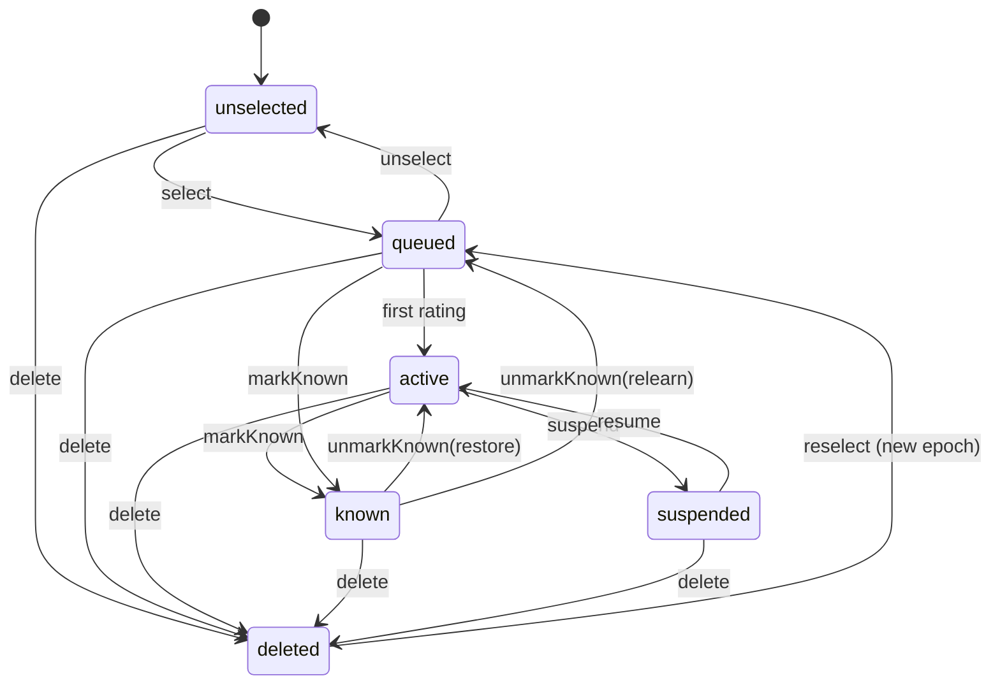

# 复习规划引擎 · 业务描述文档

| 项目 | 内容 |
|---|---|
| 文档版本 | v0.3（Developer Preview，规范候选） |
| 日期 | 2026-11-05 |
| 状态 | D1–D8 已确认；v0.3 修复领域模型混层、规则冲突与接口缺口；可作为实现基线，但尚未宣称 1.0 兼容 |
| 引擎代号 | RPE（Review Planning Engine，暂定名） |
| 规范版本 | `rpe-spec-0.3` |
| 参考产品 | 墨墨背单词（MaiMemo Vocabulary） |
| 参考策略 | FSRS-3（13 参数；MIT） |
| 规范用语 | “必须 / 不得”为强制要求；“应该”为推荐做法；“可以”为可选项（RFC 2119 风格） |
| 证据标记 | 【官方】官方文档 / 帮助页；【论文】公开论文；【社区】用户实测 / 截图；【设计】本文的设计决策 |
| 规范性 | 第 3–11 章为规范性内容；第 1 章、附录 A/C 为说明性内容；附录 B 为速查 |

> 本文只描述**行为与业务规则**，不包含参考产品的代码、词库、释义、助记、音频等内容，也不代表与其存在官方关联。参考产品的名称与商标归其权利人所有；开源项目在命名、宣传和兼容性描述中应保持事实性，不得暗示官方背书。
>
> 算法思想来自公开论文与公开文档；参考实现采用 MIT 许可的 FSRS-3，而不是复刻参考产品的私有实现。
>
> 本规范配套三份机器可读材料：`schemas/v0.3/` 定义数据契约，`conformance/business/` 定义业务规则的可执行验收场景，`conformance/fsrs3-vectors.json` 定义参考策略的数值向量。当文字与机器可读契约冲突时，以本规范的规则 ID 为准，并必须同步修正测试与 Schema。

---

## 0. 一页摘要

### 0.1 引擎要解决的两个问题

1. **长期调度**：一个单词下一次应该在哪一天复习？
2. **每日计划**：今天应该学哪些词、各学多少、按什么顺序学、同一个词今天要出现几次？

这两个问题必须分开建模。多数开源 SRS 只解决了第 1 个问题；参考产品真正形成差异的是第 2 个问题——把“复习量”和“新学量”合并成一个每日学习量，并在两者之间动态分配。

### 0.2 六条核心结论

1. **双层结构**：长期调度层负责“哪天再见”，每日计划层负责“今天学什么”。不要把两者压成一个排序器。
2. **当日首次原则**：只有“计划内、且是该词当天第一次出现”的评分，才会改变长期记忆状态；同一天后续出现的评分只影响当天队列；“今日回顾 / 历史回顾”里的评分完全不影响长期规划。【官方】
3. **学习量是总量**：默认 `每日学习量 = 当日复习量 + 当日新学量`，先复习后新学；复习多则新学少，复习少则新学多；复习积压时新学为 0。【官方】
4. **同日重复用队列位置表达**：不需要分钟级定时器。一个词在当天第几个单词之后再次出现，由队列位置决定；长期间隔只按“天”计算。
5. **策略可替换、日志可重放、结果可解释**：引擎定义行为契约与策略接口；参考策略只是其中一种实现；同样的日志重放必须得到同样的状态。
6. **参考策略已定为 FSRS-3**：它只是 `SchedulingPolicy` 的默认实现，不是业务规则；引擎的每日计划、同日队列、当日首次等规则不依赖 FSRS。

### 0.3 引擎的输出契约（概念级）

| 能力 | 输入 | 输出 |
|---|---|---|
| 命令 | 命令 ID、命令类型、载荷、时间、期望版本 | 新状态、产生的事件、错误或冲突 |
| 查询 | 用户、学习日、查询条件 | 计划、状态、预测、统计、解释 |
| 评分 | 单词、评分、上下文、时间 | 新的调度状态、下次到期日、间隔天数、解释 |
| 每日计划 | 当日状态、配置、学习日、剩余容量 | 有序队列（复习 / 新学）、目标数量、分配理由 |
| 预测 | 当前状态、未来天数 | 每日到期量、积压量、压力提示 |
| 统计 | 日志、状态 | 记忆持久度分布、遗忘曲线、每日记录 |
| 解释 | 任意结果 | “为什么是这一天 / 为什么排在这里” |

---

## 1. 项目背景与边界

### 1.1 两个项目的关系

| 项目 | 定位 | 交付物 |
|---|---|---|
| P1：复习规划引擎 | 通用、平台无关、应用形态无关的核心业务规则 | 本规范 + JSON Schema + 业务一致性测试 + FSRS-3 黄金向量 |
| P2：网页端实现 | 在当前技术环境下应用 P1 的一个完整案例 | Web 应用（非规范性参考实现） |

P1 不直接提供“可运行代码”，而是提供**可被任何语言、任何平台实现的行为契约**。这样做的好处是：十年后 Rust 可能不再流行，但“什么算一次有效复习、复习积压时新学量如何变化”这类业务规则仍然有效。

### 1.2 引擎边界

**引擎负责：**

- 单词 / 词条的身份与记忆规划状态
- 记忆状态（稳定度、难度、到期日等）
- 评分语义与长期调度
- 每日学习量、复习 / 新学分配、排序、会话队列
- 同日重复、完成判定、跳过、结转
- 到期预测、记忆持久度、遗忘曲线等统计
- 复习日志、状态快照、导入导出、确定性重放

**引擎不负责：**

- 单词内容：释义、例句、助记、音频、图片
- 词书版权与词库分发
- UI / UX、动画、手势、主题
- 账号、登录、支付、会员、单词上限售卖
- 社交、排行榜、组队、签到、补签卡
- 推送通知、日历提醒
- 云同步的传输层与冲突合并（引擎只定义数据契约）
- 具体算法参数的生产级训练（引擎定义策略接口与参考策略）

> 边界的原则：**引擎只依赖“单词 ID + 用户行为 + 配置 + 时间”，不依赖单词内容，也不依赖运行平台。**

### 1.3 设计原则

| 原则 | 含义 | 可检验的后果 |
|---|---|---|
| 行为契约优先 | 文档描述“必须发生什么”，不规定语言与架构 | 任何实现都能用同一组场景验收 |
| 确定性 | 相同输入 + 相同日志 + 相同配置 ⇒ 相同结果 | 可以回放、对账、迁移 |
| 机制与策略分离 | 引擎提供流程与不变量；算法是可替换策略 | 可以换算法而不改业务规则 |
| 平台无关 | 不假设有网络、数据库、系统时钟、UI | 可在本地、服务端、嵌入式运行 |
| 可解释 | 每个到期日、每个队列位置都有理由 | 用户能理解“为什么今天学这个” |
| 保守默认 | 默认行为优先保证记忆效果，不隐藏复习债务 | 不把“以后要还的债”伪装成“今天学得多” |
| 内容中立 | 不存储、不解析单词内容 | 可适配任何语言、任何词表 |
| 规范可判定 | 每条强制规则都有 ID、明确输入输出，并能被测试判定 | 不出现“由实现自行决定”的强制行为；若必须留白，标注 `implementation-defined` 并排除出一致性测试 |

### 1.4 非目标

- 不是一套具体算法；不是 FSRS 的封装；不是墨墨的复刻版。
- 不是数据库设计；不是 API 规范；不是 UI 规范。
- 不承诺与参考产品逐像素、逐数值一致；只承诺行为语义可对照。
- 不解决“用户是否真的想学”的动机问题；只保证计划在给定约束下自洽。

### 1.5 调研方法与可信度

本文的信息来源按可信度排序：

1. **官方文档 / 帮助页**：`maimemo.com/help30`、`memodocs.maimemo.com`。用于确定按钮语义、每日学习量、词书关系、熟知 / 删除等规则。
2. **公开论文 / 官方实验报告**：KDD 2022、TKDE 2023、2025 年算法实验报告。用于理解 MM 系列算法的演进、WDR / MMDB / MRL / SSP-MMC 等概念，以及“稳定度 / 难度 / 可提取性”模型。
3. **社区实测 / 截图**：V2EX、小红书、知乎、百度经验、什么值得买等。用于补充官方未文档化的界面行为，例如凌晨 4 点切点、“按规划 / 填满”、70/30 排序、“平衡复习压力”。

处理冲突的原则：

- 官方与社区冲突时，以官方为准；
- 只有社区证据时，写成**可配置项**，并标注【社区】，不写成“官方事实”；
- 官方文档自身存在版本差异时（例如“最长一年”与“最长间隔无固定”），保留差异说明，给出兼容默认值；
- 不把参考产品的私有参数、未公开公式写成确定结论。

---

## 2. 术语

| 术语 | 英文 / 代号 | 定义 |
|---|---|---|
| 调度单元 | Item | 引擎调度的最小单位。默认是“单词”；可配置为“单词 + 义项”。 |
| 词条 | Word | 内容层的词；一个 Item 可以引用一个 Word。 |
| 词书 | Book | Item 的一个有序集合，是“视图”，不是记忆状态的拥有者。 |
| 记忆规划 | Enrollment | 一个 Item 被用户加入学习计划后的状态记录。 |
| 学习日 | DayKey | 以用户本地时间和“跨天切点”划分的日期，精确到天。 |
| 到期 | Due | Item 的 `schedule.dueDay <= 今天`，表示可以复习。 |
| 逾期 | Overdue | `schedule.dueDay < 今天`，到期未复习。 |
| 新学 | New | Item 从未被学习过，第一次进入学习流程。 |
| 复习 | Review | Item 已有记忆数值，之后再次出现。 |
| 首次反馈 | First rating of the day | 某个 Item 在某个学习日内，第一次在“会更新长期状态”的上下文中被评分。 |
| 同日重复 | Same-day repeat | 同一个学习日内，Item 第二次及以后出现。 |
| 额外学习 | Extra | 计划完成后用户主动追加的学习；会计入统计与长期状态，但不受当日计划配额限制。 |
| 回顾模式 | Review mode | “今日回顾 / 历史回顾 / 自由回顾”等非计划内、不更新长期状态的学习。 |
| 熟知 | Known | 用户断言“已经牢固掌握”，永久退出复习计划；是生命周期，不是学习阶段。 |
| 生命周期 | Lifecycle | Item 在用户维度上的状态：`unselected / queued / active / known / suspended / deleted`。 |
| 学习阶段 | Phase | 可选的展示/策略提示：`new / learning / review / relearning`；不是权威状态。 |
| 记忆数值 | Memory values | 只包含策略使用的 `stabilityDays` 与 `difficulty`。 |
| 调度状态 | Schedule state | `dueDay / lastReviewDay / lastIntervalDays`，描述“下次何时出现”。 |
| 计数 | Counters | `reps / lapses` 等累计值，用于统计与展示，不直接参与调度公式。 |
| 稳定度 | Stability, S | 记忆强度；在参考策略中，表示“回忆概率降到 90% 所需的天数”。 |
| 难度 | Difficulty, D | Item 对用户的相对难度，通常在 1–10 之间。 |
| 可提取性 | Retrievability, R | 当前时刻能回忆起来的概率，0–1。 |
| 学习量 | Daily study amount, N | 每日计划的总量目标；默认 = 复习量 + 新学量。 |
| 复习量 | Review quota, Rq | 当日计划内复习 Item 的数量。 |
| 新学量 | New quota, Nq | 当日计划内新学 Item 的数量。 |
| 剩余容量 | Remaining capacity | `N - 当天已产生长期状态更新的 Item 数`；用于计划重算，防止重复分配。 |
| 已处理 | Settled | Item 当天不再要求出现：完成、跳过或强制结束。 |
| 已完成 | Completed | Item 当天通过“认识 / 熟知”（或配置允许的“模糊”）结束，不包含跳过。 |
| 计划 | DailyPlan | 某学习日的目标数量与有序队列。 |
| 会话 | Session | 用户从开始学习到完成 / 离开的一次队列执行过程。 |
| 命令 | Command | 对引擎的一次写请求；带 `commandId`，必须幂等。 |
| 事件 | Event | 命令产生的不可变事实；带 `eventId`，必须可重放。 |
| 策略 | Policy | 可替换的算法组件，如调度策略、排序策略、分配策略。 |
| 记忆模型 DSR | Difficulty–Stability–Retrievability | 用难度、稳定度、可提取性三个变量描述记忆状态；它是模型，不是完整调度算法。 |
| FSRS | Free Spaced Repetition Scheduler | 建立在 DSR 上的开源调度算法家族；本文参考实现固定为 FSRS-3（13 参数，MIT）。 |
| MM | MaiMemo Memory Algorithm | 墨墨背单词的私有算法家族；公开日志从 MM-0 迭代到 MM-4.4；不是 FSRS。 |
| MMX | MaiMemo Memory Algorithm for Flashcards | 墨墨记忆卡的算法线；MMX-5 是 FSRS-3 变体，MMX-6 是 FSRS-6 变体；不等同于背单词的 MM。 |
| DHP | Difficulty–Halflife–P(recall) | 墨墨论文中的长期记忆模型；用半衰期 `h` 和 `p = 2^(-Δt/h)` 描述遗忘。 |
| WDR / MMDB / MRL / SSP-MMC | — | 墨墨 MM 生态的组件或优化方法：单词难度排名 / 记忆矩阵数据库 / 用户记忆召回水平 / 随机最短路径调度。 |

---

## 3. 领域模型

### 3.1 调度单元与词书

**ITEM-001**：引擎以 `itemId` 作为唯一身份。`itemId` 必须稳定、可序列化、不依赖数据库自增。

**ITEM-002**：默认以“单词”为调度单元；同一单词在不同词书中共享同一份记忆状态。参考产品明确说明“词库是一个整体，词书只是分类”，同一单词在不同词书中的熟知度、记忆历史、下次复习时间相同。【官方】

**ITEM-003**：可以配置为“单词 + 义项”粒度。此时不同义项是不同 Item，拥有独立记忆状态；引擎不规定如何切分义项，只要求 `itemId` 能唯一标识。

**ITEM-004**：词书只保存 `itemId` 的有序列表与元数据，不得拥有或复制记忆状态。删除词书不得删除记忆状态；切换词书也不得停止已加入规划的 Item 的复习。参考产品明确：所有已加入记忆规划的单词都会按计划持续复习，不会因为切换词书就停止安排。【官方】

**ITEM-005**：引擎可以接收一个可选的 `difficultyPrior`（1–10），用于冷启动时估计单词难度；没有时使用策略默认值。该先验不随词书变化。

**ITEM-006**：引擎必须明确状态键。默认模型是“一个引擎实例绑定一个 `userId`”，此时 `itemId` 足以定位状态；如果实现支持多用户，所有状态查询与写入必须使用 `(userId, itemId)` 复合键，日志与计划也必须携带 `userId`。不得出现“日志按用户隔离、状态只按 itemId 定位”的半多用户模型。

### 3.2 记忆规划状态机

一个 Item 在用户维度上有两个正交维度：**生命周期**（权威）与**学习阶段**（可选、派生）。生命周期决定“是否进入计划”，学习阶段只用于展示与策略提示。



| 生命周期 | 含义 | 是否进入每日计划 | 是否保留记忆数值 | 是否保留调度状态 |
|---|---|---|---|---|
| `unselected` | 未加入记忆规划 | 否 | 无 | 无 |
| `queued` | 已加入，但一次都没学过 | 是（新学池） | 无 | 无 |
| `active` | 已学过，参与长期调度 | 是（复习池） | 有 | 有 |
| `known` | 熟知，永久退出 | 否 | 保留（用于统计 / 撤销） | 保留快照，但当前无 `dueDay` |
| `suspended` | 暂停 / 不想背 | 否 | 保留 | 保留 |
| `deleted` | 已删除，记忆数据清空 | 否 | 无（逻辑墓碑） | 无 |

**ENR-001**：`known`、`suspended`、`deleted` 的 Item 不得出现在每日计划、到期预测、复习队列中。

**ENR-002**：`queued` 的 Item 没有记忆数值，也没有 `dueDay`；第一次“会更新长期状态”的评分后才创建 `memory` 与 `schedule`，并转为 `active`。

**ENR-003**：`delete` 必须清空该 Item 的记忆数值、调度状态、`knownAt`、`knownSnapshot`、`firstLearnedDay` 与计数；再次加入时按新词处理，并开启新的 `enrollmentEpoch`。参考产品明确“删除会清空该单词所有记忆数据”。【官方】日志保留为审计记录，但旧 epoch 的日志不得用于重建新 epoch 的状态。

**ENR-004**：`suspend` 与 `delete` 不同：暂停保留记忆数值与调度状态；恢复时默认 `dueDay = max(原 dueDay, 今天)`，避免一恢复就产生大量逾期。该行为由 `resumeDuePolicy = keep | today | max` 控制。

**ENR-005**：`markKnown` 是用户断言，不是算法自动判定。参考产品将“熟知”定义为“即使不复习也能记住超过 1 年”，但引擎不得仅凭间隔自动标记熟知。【官方】

**ENR-006**：`unmarkKnown` 的行为必须明确：默认 `restore`，恢复标记前的调度状态快照（`knownSnapshot`）；若没有快照，则按 `relearn` 处理，生命周期回到 `queued`，不保留旧的 `dueDay`。该行为由配置 `knownUndoPolicy = restore | relearn` 控制。

**ENR-007**：`phase` 不是权威状态。引擎不得根据 `phase` 判断是否到期、是否进入计划或是否更新长期状态；这些判断只能使用 `lifecycle` 与 `schedule`。实现可以省略 `phase`，或从 `lifecycle` 与 `counters` 派生。

**ENR-008**：`markKnown` 是终止命令，可以在同一天的任何时刻执行，包括该词当天已经有过首次评分之后。它必须覆盖当天的调度结果：清除当前 `dueDay`，保存 `knownSnapshot`，写 `marked_known` 事件；不得再为该词安排同日重复。`unmarkKnown` 同一天内仍按上述规则恢复。

**ENR-009**：`unselectItems` 只允许 `queued` / `unselected` 的 Item；对 `active` / `known` / `suspended` 的 Item，必须先 `delete`（清空记忆）或 `suspend`（保留记忆但退出计划）。`unselectItems` 不得静默清空已学记忆；违反时返回 `ITEM_NOT_ACTIVE`。这样 `unselected` 的“无 memory / 无 schedule”才与状态表一致。

### 3.3 条目状态（ItemState）

`MemoryState` 不再作为“大杂烩”对象。规范使用 `ItemState`，并把字段按职责分为四组：

| 字段 | 类型 | 说明 |
|---|---|---|
| `userId` | string \| null | 单用户实例可为 null；多用户实例必填 |
| `itemId` | string | 调度单元 ID |
| `lifecycle` | enum | `unselected / queued / active / known / suspended / deleted` |
| `phase` | enum \| null | 可选：`new / learning / review / relearning`；仅用于展示，不是权威状态 |
| `memory` | object \| null | 记忆数值，见下表；`queued` 时为 null |
| `schedule` | object \| null | 调度状态，见下表；`queued` 时为 null |
| `counters` | object | 计数，见下表 |
| `firstLearnedDay` | DayKey \| null | 第一次学习日 |
| `knownAt` | timestamp \| null | 标记熟知的时间 |
| `knownSnapshot` | object \| null | 标记熟知前的 `memory + schedule` 快照，用于 `restore` |
| `enrollmentEpoch` | integer ≥ 1 | 删除后重新加入时递增；用于隔离旧日志 |
| `version` | integer | 乐观并发版本 |

**memory（记忆数值）**

| 字段 | 类型 | 说明 |
|---|---|---|
| `stabilityDays` | number ≥ 0 | 稳定度；参考策略中为“回忆概率降到 90% 的天数” |
| `difficulty` | number 1–10 | 难度 |

**schedule（调度状态）**

| 字段 | 类型 | 说明 |
|---|---|---|
| `dueDay` | DayKey \| null | 下次到期日；只精确到天；`known` 时为 null |
| `lastReviewDay` | DayKey \| null | 上次“会更新长期状态”的评分所属学习日 |
| `lastIntervalDays` | integer \| null | 最近一次安排的间隔 |

**counters（计数）**

| 字段 | 类型 | 说明 |
|---|---|---|
| `reps` | integer ≥ 0 | 长期评分次数（不含同日重复、回顾模式）；`known` 不计入 |
| `lapses` | integer ≥ 0 | “计划内 / 额外学习首次评分为忘记”的次数 |

**STATE-001**：`schedule.dueDay`、`schedule.lastReviewDay` 必须是 DayKey（整数天），不得存“某日 14:30”这种时刻；同日重复不写 `dueDay`。

**STATE-002**：`memory.stabilityDays` 与 `memory.difficulty` 的语义由策略定义；引擎只要求它们可序列化、可解释、可版本化。

**STATE-003**：状态快照可以丢失，但只要能拿到完整日志（含 `enrollmentEpoch`），就必须能重建到相同状态。

**STATE-004**：`dueDay` 属于调度状态，不属于记忆数值。`defer`、`suspend/resume`、`fill` 等操作只修改 `schedule`，不得被描述为“修改记忆状态”。

**STATE-005**：`knownSnapshot` 必须保存 `restore` 所需的最小字段：`memory`、`schedule.dueDay`、`schedule.lastReviewDay`、`schedule.lastIntervalDays`、`phase`。恢复时若快照中的 `dueDay` 已早于今天，按 `resumeDuePolicy` 处理，默认 `max(dueDay, 今天)`。

**STATE-006**：`phase` 与 `lifecycle` 不得互相推导为权威状态。例如 `phase = review` 不代表 `lifecycle = active` 一定成立；判断计划归属必须以 `lifecycle` 为准。

**STATE-007**：`phase` 可以为 `null`。若实现生成 `phase`，它只能由 `lifecycle`、`counters` 与 `schedule` 派生，仅用于展示；不得参与调度、计划、配额、排序或一致性判定。跨实现不要求 `phase` 取值一致。

### 3.4 学习事件日志（StudyEvent）

日志是不可变事实，不是“可覆盖的状态”。规范使用统一的 `StudyEvent`，而不是只为评分设计的 `ReviewLog`；评分事件是其中一种 `eventType`。

| 字段 | 类型 | 说明 |
|---|---|---|
| `eventId` | string | 全局唯一；标识事件 |
| `commandId` | string | 产生该事件的命令；用于幂等 |
| `userId` | string \| null | 用户；单用户实例可为 null |
| `itemId` | string \| null | 调度单元；配置/计划事件可为 null |
| `enrollmentEpoch` | integer \| null | 该事件所属的加入周期；删除后重新加入时递增 |
| `at` | string | UTC 时间戳（ISO 8601） |
| `dayKey` | DayKey | 该事件归属的学习日 |
| `timezone` | string | 事件发生时的 IANA 时区 |
| `eventType` | enum | 见 §8.2；至少包含 `study_rated / marked_known / unmarked_known / item_skipped / item_deferred / forced_complete / settings_changed / plan_generated / plan_replanned / item_deleted / rating_corrected` |
| `context` | enum \| null | `scheduled / extra / same_day_repeat / today_review / history_review / free_review`；仅学习事件有 |
| `rating` | enum \| null | `know / vague / forgot`；仅 `study_rated` 事件有。`known` 是 `marked_known` 事件，不是评分 |
| `wasNew` | boolean \| null | 该次评分是否把 Item 从 `queued` 变为 `active`；仅 `study_rated` 事件有，用于统计与计划归属 |
| `elapsedDays` | integer \| null | 距上次长期评分的实际日历天；首次为 null |
| `scheduledIntervalDays` | integer \| null | 上次安排的间隔；用于对照，不参与状态更新 |
| `policyIntervalDays` | integer \| null | 策略返回值，未经业务覆盖 |
| `intervalAfter` | integer \| null | 本次实际安排的天数 |
| `stateBefore` / `stateAfter` | object \| null | 审计快照；只读，不得作为重放输入 |
| `queueAppearance` | integer \| null | 当天第几次出现（1 起） |
| `sessionId` / `planId` | string \| null | 会话与计划 |
| `policyId` / `policyVersion` / `paramsHash` | string \| null | 策略版本 |
| `responseMs` | number \| null | 可选，客户端上报的响应时间 |
| `clientId` | string \| null | 可选，设备标识（不含 PII） |

**LOG-001**：任何写命令都必须产生至少一个事件，包括不影响长期状态的回顾模式评分、跳过、暂停、删除与配置变更。

**LOG-002**：日志一旦写入不得修改；更正只能追加 `rating_corrected` 事件，并在导出时标注原事件。更正事件不得删除或覆盖原事件。

**LOG-003**：日志必须能区分“会更新长期状态”和“不会更新长期状态”的上下文，否则无法正确重放。`scheduled` 与 `extra` 是更新上下文；`same_day_repeat`、`today_review`、`history_review`、`free_review` 是不更新上下文。

**LOG-004**：`commandId` 用于幂等去重，`eventId` 用于事件引用；一个命令可以产生多个事件，但同一 `commandId` 重放不得产生新事件。

**LOG-005**：`stateBefore` / `stateAfter` 是审计字段，不是重放输入。重放必须从初始快照和事件序列重新计算状态；不得直接采用 `stateAfter`。

**LOG-006**：`enrollmentEpoch` 必须写入所有与 Item 状态相关的事件。删除后重新加入会开启新 epoch；重放时旧 epoch 的事件不得影响新 epoch 的状态。

**LOG-007**：`rating` 只允许出现在 `study_rated` 事件中。`skipped` 不是评分，必须用 `item_skipped` 事件表达；`known` 不是评分，必须用 `marked_known` 事件表达。适配层可以在 API 层继续接受 `known` / `skipped` 作为便捷参数，但落库前必须转换成规范事件。

**LOG-008**：`study_rated` 必须记录 `wasNew`。`wasNew = true` 当且仅当评分前的 `lifecycle = queued`，且该 Item 在当前 `enrollmentEpoch` 内还没有过会更新长期状态的评分；否则为 `false`。`wasNew` 用于新学/复习统计和计划归属，不得在重放时重新猜测。

### 3.5 每日计划（DailyPlan）与会话（Session）

**DailyPlan**

| 字段 | 说明 |
|---|---|
| `planId` | 计划 ID |
| `userId` / `dayKey` | 归属 |
| `generatedAt` | 生成时间 |
| `configHash` | 生成时的配置指纹 |
| `mode` | `merged` / `split` |
| `targets` | `{ total, review, new }`；与 `reviewTarget` / `newTarget` 同义 |
| `reviewItems` / `newItems` | 有序的 item 引用 |
| `advancedItemIds` | `fill` 模式下被提前复习的 Item；不得只靠日志推断 |
| `settledItemIds` / `completedItemIds` | 已处理 / 已完成；用于区分跳过与完成 |
| `status` | `active / completed / superseded` |
| `version` | 计划版本；配置变更或重算时递增 |

**Session**

| 字段 | 说明 |
|---|---|
| `sessionId` | 会话 ID |
| `planId` | 所属计划 |
| `queue` | 当前有序队列（item + role + appearance） |
| `cursor` | 当前位置；重算时按 `itemId` 保留，不得用数组下标 |
| `appearances` | 每个 item 当天已出现次数 |
| `settled` / `completed` / `skipped` | 已处理 / 已完成 / 已跳过的 item 集合 |
| `status` | `active / paused / completed / closed` |
| `startedAt` / `closedAt` | 时间 |

**PLAN-001**：计划是“当日快照”，不是永久事实；跨天后必须重新生成。

**PLAN-002**：计划中可以包含未开始的 Item；已完成的 Item 不因计划重算而回退。

**PLAN-003**：会话队列必须能从“计划 + 日志 + 配置”重建；允许保存快照以加速恢复，但快照不得成为唯一真相。重建算法见 QUEUE-007。

**PLAN-004**：`DailyPlan.status = completed` 的条件是所有计划内 Item 都已 `settled`（完成、跳过或强制结束），不是所有 Item 都 `completed`。

### 3.6 配置（EngineConfig）

配置在序列化时可以保持扁平，但在概念上必须分为三组：`PlannerConfig`（计划）、`TimeConfig`（时间）、`PolicyRef`（策略）。实现不得把策略参数写死在业务代码里。

| 配置项 | 类型 | 默认值 | 层 | 说明 |
|---|---|---|---|---|
| `dailyStudyAmount` | int ≥ 0 | 100 | Planner | 每日学习量目标（合并模式的总量） |
| `volumeMode` | `merged` / `split` | `merged` | Planner | 复习量与新学量是否合并 |
| `dailyReviewQuota` | int ≥ 0 | — | Planner | 分开模式下的复习量；分开模式必填 |
| `dailyNewQuota` | int ≥ 0 | — | Planner | 分开模式下的新学量；分开模式必填 |
| `reviewFillMode` | `by_plan` / `fill` | `by_plan` | Planner | 只复习到期词，还是提前复习填满 |
| `studyOrder` | `review_first` / `new_first` / `shuffled` | `review_first` | Planner | 复习与新学的先后 |
| `reviewOrder` | `risk` / `balanced` / `reference_70_30` / `custom` | `risk` | Planner | 复习排序策略 |
| `newOrder` | `book` / `random` / `frequency` / `priority` | `book` | Planner | 新学排序 |
| `allowVagueComplete` | bool | `false` | Planner | 同日重复时“模糊”是否算完成当天复习 |
| `maxIntervalDays` | int ≥ 1 | 365 | Planner | 长期间隔上限 |
| `minIntervalDays` | int ≥ 1 | 1 | Planner | 长期间隔下限；必须 ≤ `maxIntervalDays` |
| `forgotNextDay` | bool | `true` | Planner | “忘记”是否固定次日到期；false 时使用策略间隔 |
| `sameDayGap` | int ≥ 0 \| null | 5 | Planner | 同日重复往后插入的位置；`0` 表示立即再出现；`null` 表示队尾 |
| `maxAppearancesPerDay` | int ≥ 1 \| null | null | Planner | 单日最多出现次数；null 为不限制 |
| `vagueMaxIntervalDays` | int ≥ 1 \| null | 3 | Planner | “模糊”后长期间隔的上限；null 表示完全由策略决定 |
| `newWordsBlockedByBacklog` | bool | false | Planner | 分开模式下，复习池超过配额时是否阻断新学 |
| `resumeDuePolicy` | `keep` / `today` / `max` | `max` | Planner | 暂停/取消熟知恢复时的到期日处理 |
| `pressureBalance` | `off` / `reserve_new` / `spread_backlog` | `off` | Planner | 复习压力平衡策略 |
| `newReserveRatio` | number 0–1 | 0.2 | Planner | 积压时为新学保留的比例 |
| `dailyMaxReview` | int ≥ 1 \| null | null | Planner | `spread_backlog` 每天最多安排的复习量；null 表示等于 `dailyStudyAmount` |
| `maxNewPerDay` | int ≥ 0 \| null | null | Planner | 新学量硬上限 |
| `overdueCapDays` | int ≥ 0 \| null | null | Planner | 逾期计入策略输入的上限；null 为不封顶 |
| `knownUndoPolicy` | `restore` / `relearn` | `restore` | Planner | 取消熟知后的处理 |
| `planHorizonDays` | int ≥ 1 | 30 | Planner | 预测天数 |
| `targetRetention` | number (0,1) | 0.9 | Policy | 目标保留率（参考策略参数） |
| `dayCutoffMinutes` | int 0–720 | 240 | Time | 跨天切点，默认 04:00 |
| `timezone` | IANA string | 系统时区 | Time | 学习日计算时区；必须持久化，不得每次取系统值 |
| `policyId` | string | `fsrs-3` | Policy | 策略标识；必须与日志中的策略元数据一致 |
| `policyVersion` | string | `3.0` | Policy | 策略实现版本；必须固定 |
| `policyParams` | JSON | 策略默认 | Policy | 策略参数；必须符合策略 Schema |
| `policyParamsHash` | string | 派生 | Policy | `sha256:` + JCS(`policyParams`) 的十六进制摘要 |

**CFG-001**：配置变更必须写 `settings_changed` 事件；计划按新配置重算未开始部分。已完成部分不得回退。

**CFG-002**：配置必须可导出、可版本化；不得把关键行为藏在不可见的服务端开关里。

**CFG-003**：默认值应尽量贴近参考产品的可见行为；但每个默认值都必须可改，并在文档中说明其影响。

**CFG-004**：配置写入前必须校验。至少包括：

| 校验 | 规则 | 失败行为 |
|---|---|---|
| 间隔边界 | `1 ≤ minIntervalDays ≤ maxIntervalDays` | 拒绝配置，保留旧值 |
| 模糊上限 | `vagueMaxIntervalDays == null` 或 `≥ 1` | 拒绝配置 |
| 目标保留率 | `0 < targetRetention < 1` | 拒绝配置；1 会让间隔公式退化 |
| 同日间隔 | `sameDayGap == null` 或 `≥ 0` | 拒绝配置 |
| 出现次数 | `maxAppearancesPerDay == null` 或 `≥ 1` | 拒绝配置 |
| 分开模式 | `volumeMode = split` 时必须提供 `dailyReviewQuota` 与 `dailyNewQuota` | 拒绝配置 |
| 压力平衡 | `newReserveRatio ∈ [0,1]`；`dailyMaxReview == null` 或 `≥ 1` | 拒绝配置 |
| 时间 | `dayCutoffMinutes ∈ [0,720]`；`timezone` 是有效 IANA 标识 | 拒绝配置 |
| 策略 | `policyId` / `policyVersion` 非空；`policyParamsHash` 与参数一致 | 拒绝配置 |

**CFG-005**：配置校验失败必须返回 `INVALID_CONFIG`，不得静默 clamp 或只写警告。读取旧配置时若发现越界，必须使用文档化的迁移默认值，并写 `settings_migrated` 事件。

**CFG-006**：运行中修改 `targetRetention`、`maxIntervalDays` 或 `minIntervalDays` 时，默认只影响之后的评分，不重算已有 `dueDay`；若要重算，必须走显式迁移命令并记录 `policy_migrated` 或 `schedule_migrated` 事件。

### 3.7 时间模型

**TIME-001**：引擎内部只使用两种时间：UTC 时间戳（日志）与 DayKey（调度）。所有长期调度按天计算，不按小时。

**TIME-002**：DayKey 的计算方式：

```
local = 在 timezone 下将 at 转换为本地日期时间
if local.time < dayCutoff:
    calendarDate = local.date - 1 day
else:
    calendarDate = local.date
dayKey = daysSinceEpoch(calendarDate)
```

`daysSinceEpoch` 必须是“proleptic Gregorian 日历日期距 1970-01-01 的天数”，按日期整数计算，不依赖 UTC 时刻，也不依赖本地时区偏移。也就是说，`2026-11-04` 在任何时区都映射到同一个整数。

例如切点为 04:00：某日 02:00 属于前一天；04:00 起属于新一天。

**TIME-003**：DayKey 必须是整数（如“距 1970-01-01 的天数”），不得使用本地化字符串作为主键。DayKey 一旦写入事件，不得因时区变更而重算。

**TIME-004**：`elapsedDays = 今天 - lastReviewDay`，按日历天计算，不按 24 小时毫秒数计算；跨夏令时也按日历天。

---

## 4. 长期调度：一个单词下一次哪天出现

### 4.1 最重要的规则：当日首次、计划内

**SCH-001**：只有同时满足以下条件的评分，才会更新长期记忆/调度状态：

1. `context ∈ { scheduled, extra }`；
2. 该 Item 在该学习日内，之前没有任何 `scheduled` 或 `extra` 评分。

`scheduled` 是计划内学习/复习；`extra` 是计划完成后用户主动追加的学习。两者都代表“真实的首次学习”，必须更新长期状态；区别只在于 `extra` 不受当日计划配额限制。

**SCH-002**：同一天内第二次及以后出现的评分（`context = same_day_repeat`），无论点“认识 / 模糊 / 忘记”，都**不得**改变 `schedule.dueDay`、`memory.stabilityDays`、`memory.difficulty`、`counters.reps`、`counters.lapses`，只影响当天队列。

**SCH-003**：`today_review`、`history_review`、`free_review` 上下文的评分，无论是否当天第一次，都**不得**改变长期状态。参考产品明确：“今日回顾”和“历史回顾”的所有记忆反馈都不会影响单词未来在第几天出现。【官方】

**SCH-004**：如果一个到期词先在“历史回顾”里被评分，之后又出现在计划内，计划内的评分仍然是该词当天的“首次会更新长期状态的评分”，应当更新长期状态；回顾模式的那次评分只写事件日志。

**SCH-005**：同一个 Item 在同一个学习日、同一个 `enrollmentEpoch` 内，最多只能有一次长期状态更新；重复提交同一 `commandId` 必须幂等，不得重复计算或重复写事件。

**SCH-006**：如果当天没有会更新长期状态的评分（用户没学），则状态不变，`dueDay` 保持原值；第二天它自然成为逾期词。

**SCH-006a**：`extra` 学习计入每日统计（新学/复习、评分分布、学习时长），但不占用当天 `dailyStudyAmount` 配额，也不得让 `DailyPlan` 回退为“未完成”。计划完成后再追加的词，进入 `extra` 队列。

**SCH-006b**：`markKnown` 不是评分，不受“一天只能更新一次”限制；它是终止命令，按 ENR-008 执行。`markKnown` 不计入 `reps`，也不增加 `lapses`。

| 上下文 | 是否更新长期状态 | 是否计入计划配额 | 典型场景 |
|---|---|---|---|
| `scheduled` | 是（当天首次） | 是 | 今日计划内学习 |
| `extra` | 是（当天首次） | 否 | 计划完成后主动加词 |
| `same_day_repeat` | 否 | 否 | 忘记/模糊后的同日复现 |
| `today_review` | 否 | 否 | 今日回顾 |
| `history_review` | 否 | 否 | 历史回顾 |
| `free_review` | 否 | 否 | 自由复习 |

> 这条规则是整套引擎最容易被实现错的地方。很多 SRS 会把同一天内的每次评分都拿来更新稳定度，导致“越复习越记不住”或“同一天点两次认识，间隔翻倍”。参考产品的语义是：**一天只认第一次会更新长期状态的评分。**

### 4.2 四类操作的语义

| 操作 | 用户含义 | 长期影响 | 当日队列 | 统计归类 |
|---|---|---|---|---|
| 认识 `know` | 发音、拼写、释义能迅速回忆 | 稳定度上升；`dueDay = 今天 + clamp(I, minIntervalDays, maxIntervalDays)` | 当天不再出现（除非被其他规则重新加入） | 复习成功 / 新学成功 |
| 模糊 `vague` | 发音略错、拼写错几个字母、释义“好像知道但说不清” | 稳定度按策略调整；`vagueMaxIntervalDays != null` 时 `dueDay = 今天 + min(I, vagueMaxIntervalDays)`，否则 `dueDay = 今天 + clamp(I, minIntervalDays, maxIntervalDays)` | 当天至少再出现 1 次 | 复习困难 / 新学困难 |
| 忘记 `forgot` | 音、形、义完全没印象 | 稳定度下降或重置；`forgotNextDay = true` 时 `dueDay = 明天`，否则使用策略间隔 | 当天至少出现 2 次（首次 + 至少 1 次重复） | 复习失败 / 新学失败；`lapses + 1` |
| 熟知 `known` | 确定已经记牢 | 终止调度，不再有 `dueDay` | 立即移出队列 | 熟知 |

**SCH-007**：“认识”不等于“永远记住”。参考产品明确算法中没有“完全记住”的概念，间隔会越来越长但不会停止，直到用户标记“熟知”。【官方】

**SCH-008**：“熟知”是**终止动作**，不是第四档评分。默认不得把“熟知”映射成调度评分中的“简单 / Easy”；如果某个策略需要四档评分，可以由适配层把“熟知”映射为 Easy，但必须同时执行终止语义。

**SCH-009**：“忘记”后的次日到期是参考产品的可见行为（“极大概率第二天再次出现”）。【官方】`forgotNextDay = true`（默认）时，引擎使用确定性的次日到期；`forgotNextDay = false` 时，使用策略返回的间隔，但仍必须经过 `minIntervalDays / maxIntervalDays` 边界校验。

**SCH-010**：“模糊”的长期间隔必须较短（1 天或几天）；引擎不得把“模糊”当成“认识”的轻微版本而给出长间隔。参考策略 R1 对“模糊”的间隔强制截断到 `vagueMaxIntervalDays`（默认 3 天），即使 FSRS 的 Hard 分支返回更长的间隔。策略内部仍按 Hard 分支更新稳定度；截断是业务层规则，不是公式的一部分。`vagueMaxIntervalDays = null` 时不做截断，但应用必须显式提示“模糊可能给出长间隔”。

**SCH-011**：`markKnown` 是终止命令，可以在同一天的任何时刻执行，包括该词当天已经有过首次评分之后。它必须覆盖当天的调度结果：清除当前 `dueDay`，保存 `knownSnapshot`，写 `marked_known` 事件；不得再为该词安排同日重复。`unmarkKnown` 按 ENR-006 恢复。

**SCH-012**：计数口径必须固定：

- `reps` 只统计 `scheduled` / `extra` 中当天首次、且非 `known` 的评分；
- `lapses` 只统计上述评分中 `rating = forgot` 的次数；
- 同日重复、回顾模式、跳过、`known` 均不增加 `reps` 或 `lapses`；
- 每日统计中的“忘记次数”可以统计所有上下文的评分，但必须与 `lapses` 分开命名。

> 计数口径：`lapses` 只统计“计划内首次评分为忘记”的长期失败，不统计同日重复时的忘记；每日统计中的“忘记次数”则应统计所有上下文的所有评分。两者不要混用。

### 4.3 同日重复规则

同日重复不是“再次调度”，而是“队列控制”。

**QUEUE-001**：一个 Item 当天第一次出现并评分后，按评分决定是否重新入队：

| 首次评分 | 是否重新入队 | 最少当天出现次数 |
|---|---|---|
| 认识 | 否 | 1 |
| 模糊 | 是 | 2 |
| 忘记 | 是 | 2 |
| 熟知 | 否（终止） | 1 |

**QUEUE-002**：重新入队的位置由 `sameDayGap` 决定：

- `sameDayGap = null`：放到队尾；
- `sameDayGap = 0`：立即再次出现（插入到当前队首）；
- `sameDayGap = k > 0`：在当前队列中往后数 `k` 个 Item 后插入；若剩余不足 `k`，放到队尾；若队列已空，立即再次出现。

实现必须使用“插入到索引 `min(k, rest.length)`”这一确定性规则；`k = 0` 与 `null` 不得混淆。

**QUEUE-003**：重复出现时的评分只影响“是否继续留在队列”，不改变长期状态。即使重复时点了“认识”，长期 `dueDay` 仍由当天第一次会更新长期状态的评分决定。

**QUEUE-004**：完成当天复习的判定：

- 默认 `allowVagueComplete = false`：只有“认识”或“熟知”能让该 Item 完成当天复习；“模糊”“忘记”都会继续留在队列。
- 若 `allowVagueComplete = true`：同日重复时的“模糊”可以完成当天复习；“忘记”仍然不能完成。
- 首次“模糊”始终至少再出现 1 次；`allowVagueComplete` 只影响重复出现时能否结束，不取消首次的复现要求。
- “完成”只表示“当天不再要求出现”，不表示“记住”。

**QUEUE-005**：`maxAppearancesPerDay` 默认不限制。若配置了上限，达到上限后必须记录 `forced_complete` 事件，并把该 Item 视为“当天已处理但未掌握”。`forced_complete` 只结束当天队列，不得修改长期 `dueDay`、`stabilityDays`、`difficulty` 或 `lapses`；这与 SCH-002 的“一天最多一次长期更新”一致。若产品希望更短间隔，只能在首次评分时由策略决定，不能在同日重复时补救。

**QUEUE-006**：用户主动“跳过”某个 Item 时，写 `item_skipped` 事件；复习词保持到期，新词保持未学；跳过不改变长期状态，也不计入 `completed`，但计入 `settled`。

**QUEUE-007**：会话队列必须可以确定性重建。重建算法：

1. 从 `DailyPlan` 的 `reviewItems + newItems` 初始化队列；
2. 按日志时间顺序（`at`，同一时刻按 `eventId` 字典序）重放当天的 `study_rated` / `marked_known` / `item_skipped`；
3. 对 `vague` / `forgot` 的首次评分，按 QUEUE-002 重新插入；对 `same_day_repeat` 的评分，按 QUEUE-004 决定是否继续；
4. 同一位置有多个待插入 Item 时，按日志顺序稳定插入（后到者排在前者之后）；
5. 不允许依赖数组下标恢复游标；游标必须按 `itemId` 恢复。

**QUEUE-008**：用户关闭会话后重新进入，默认恢复同一 `sessionId` 的队列；若跨天，关闭会话并按新计划生成新队列。应用可以只恢复“未处理 Item”，但必须保留 `settled` / `completed` / `skipped` 集合，以免重复计数。

### 4.4 下次到期日的计算

**SCHED-001**：对一次有效的长期评分，策略返回 `policyIntervalDays`，引擎计算：

```
policyIntervalDays = policy.nextInterval(memory, rating, elapsedDays, policyConfig)
intervalDays = clamp(policyIntervalDays, minIntervalDays, maxIntervalDays)
dueDay = dayKey + intervalDays
```

业务覆盖（忘记/模糊）见 SCHED-004 / SCHED-005；`dueDay` 始终是 DayKey 加整数天。

**SCHED-002**：`minIntervalDays` 默认 1；不允许出现“认识后当天再次长期到期”的情况。同日重复由队列负责，不由 `dueDay` 负责。

**SCHED-003**：`maxIntervalDays` 默认 365。参考产品帮助页写“最长一年”；其新版文档又写“最长间隔无固定”。【官方】本文取 365 作为兼容默认值，并允许配置为更大的值（例如 36500）。

**SCHED-004**：对“忘记”，若 `forgotNextDay = true`（默认），直接 `dueDay = dayKey + 1`，不经过策略的间隔计算；但策略仍负责更新稳定度/难度。若 `forgotNextDay = false`，使用 `clamp(policyIntervalDays, minIntervalDays, maxIntervalDays)`。这样既符合参考产品的可见行为，也保证“忘记后次日必复习”可测试。

**SCHED-005**：对“模糊”，若 `vagueMaxIntervalDays != null`，使用 `min(clamp(policyIntervalDays, minIntervalDays, maxIntervalDays), vagueMaxIntervalDays)`；若为 null，使用普通 clamp。参考产品的可见描述是“1 天或几天”，不应出现长间隔。截断只影响 `dueDay`，不覆盖策略返回的稳定度；解释中必须同时给出“策略间隔”和“实际间隔”。

**SCHED-006**：所有取整必须明确规则。规范默认使用 **half-up（正数 `floor(x + 0.5)`）**，不得使用语言默认的银行家舍入。策略版本必须固定取整方式，避免同一日志在不同实现中产生不同日期。

**SCHED-006a**：`policyIntervalDays` 是策略公式直接算出的值，未经业务覆盖；`intervalDays` 是最终写入 `dueDay` 的值。解释对象必须同时保留两者，便于区分“算出来”和“实际安排”。

**SCHED-006b**：`maxIntervalDays` 的所有权属于业务层。策略可以接收它作为参数，但即使策略返回更大的值，引擎仍必须在 `dueDay` 写入前 clamp。

### 4.5 逾期处理

**SCHED-007**：`dueDay < 今天` 的 Item 进入复习池，优先级按“遗忘风险”处理，而不是按原计划日期简单排队。

**SCHED-008**：计算新的记忆状态时，`elapsedDays` 必须使用**实际经过的日历天**（`今天 - lastReviewDay`），不得使用“原计划间隔”。这是一个常见 bug：安排 71 天、实际 583 天后才复习，却按 71 天更新状态，会严重高估记忆水平。

**SCHED-009**：`overdueCapDays` 只用于限制传给策略的 `elapsedDays` 上限，日志中仍记录真实值；默认 null（不封顶）。设置上限时必须在解释中注明“已截断”。

**SCHED-010**：逾期不产生额外惩罚状态；惩罚应体现在策略对低可提取性的处理上，而不是业务层偷偷扣分。

### 4.6 新词、熟知、删除、暂停

**NEW-001**：新词第一次进入计划时，`lifecycle = queued`；可以派生 `phase = new`，但没有 `memory` 与 `schedule`。

**NEW-002**：新词第一次会更新长期状态的评分后，策略必须给出初始稳定度与难度；`lifecycle = active`，`counters.reps = 1`，`firstLearnedDay = dayKey`，并计算 `schedule.dueDay`。`phase` 可以由引擎派生为 `review` 或 `learning`，但不得由策略返回，也不得用于判断计划归属。

**NEW-003**：新词当天被评“忘记”后，仍然只算一次“新学”；同一天的重复不重复计入新学数量。

**KNOWN-001**：标记熟知后，`lifecycle = known`，清除当前 `schedule.dueDay`，保存 `knownSnapshot`；保留历史状态用于统计和撤销。不得写 `phase = known`，因为 `known` 不属于 `phase` 枚举。

**KNOWN-002**：熟知词不计入到期预测、复习量、新学量；可以在“已学列表”中单独统计。

**KNOWN-003**：`unmarkKnown` 默认 `restore`：从 `knownSnapshot` 恢复 `memory + schedule`；若快照中的 `dueDay` 早于今天，按 `resumeDuePolicy` 处理（默认 `max(dueDay, 今天)`）。若 `knownUndoPolicy = relearn` 或没有快照，则 `lifecycle = queued`，`memory`、`schedule`、`knownAt`、`knownSnapshot`、`firstLearnedDay` 与计数全部清空/归零，重新按新词学习。

**DELETE-001**：删除是逻辑删除；`memory` 与 `schedule` 清空；日志保留为审计记录（除非用户请求彻底清除）。再次加入时按 `queued` 处理，并递增 `enrollmentEpoch`。

**DELETE-002**：删除后重新加入必须开启新的 `enrollmentEpoch`。旧 epoch 的事件可以保留用于审计，但不得参与新 epoch 的状态重建、统计去重或计划生成。

**SUSPEND-001**：暂停词不进入计划；恢复时按 `resumeDuePolicy` 处理：`keep` 保留原到期日，`today` 设为今天，`max` 设为 `max(原 dueDay, 今天)`（默认）。

### 4.7 不变量

| 编号 | 不变量 |
|---|---|
| INV-001 | 同一个 Item 在同一个学习日、同一个 `enrollmentEpoch` 内，长期状态最多更新一次 |
| INV-002 | `known` / `suspended` / `deleted` 的 Item 不出现在计划与预测中 |
| INV-003 | `schedule.dueDay` 是 DayKey，不含时刻 |
| INV-004 | 有效长期评分后，`schedule.dueDay > dayKey`（`known` 除外） |
| INV-005 | 同一天内的重复评分不改变 `schedule.dueDay` |
| INV-006 | 新词在首次评分前没有 `memory` 与 `schedule` |
| INV-007 | 相同日志 + 相同配置 + 相同策略版本 ⇒ 相同状态；`stateAfter` 不作为重放输入 |
| INV-008 | `today_review` / `history_review` / `free_review` 评分不改变长期状态 |
| INV-009 | `scheduled` 与 `extra` 都是会更新长期状态的上下文；`extra` 不占计划配额 |
| INV-010 | 一个 `commandId` 最多产生一组事件；重复命令不得重复计数 |
| INV-011 | `known` 是生命周期，不是 `phase`；`phase` 不得用于判断计划归属 |

---

## 5. 每日计划：今天学什么、学多少、什么顺序

### 5.1 学习量的定义

**PLAN-010**：默认（合并模式）：

```
每日学习量 N = 当日复习量 Rq + 当日新学量 Nq
```

N 是**目标**，不是硬上限。用户完成计划后仍可主动追加学习；追加不受 N 限制，但会增加未来的复习负担。【官方】

**PLAN-011**：N 本质上是“每天愿意投入多少时间”的代理。引擎按“Item 数”计算；应用层可以用平均耗时把分钟映射为数量，但引擎不负责测量时间。

**PLAN-012**：参考产品不推荐把“每日复习量”和“每日新学量”分开固定，因为固定新学量会让复习量持续累积。【官方】因此：

- 合并模式是默认；
- 分开模式必须可用，但应用应显示“复习债务”提示；
- 引擎不得在用户不知情的情况下把固定新学量当作可持续策略。

### 5.2 计划生成流程

在每天第一次打开应用（或跨天切点之后）生成计划；同一天重算时也必须从“剩余容量”出发：

```
1. 计算 dayKey
2. 取状态快照与当天日志
3. reviewPool = 所有 active 且 dueDay <= dayKey 的 Item（按复习排序策略排序）
4. futurePool = 所有 active 且 dueDay > dayKey 的 Item（按 dueDay 升序）
5. newPool = 所有 queued 的 Item
6. doneScheduledToday = 当天 context = scheduled 且已产生长期状态更新的 Item 集合
   doneNewToday       = 其中首次学习时 wasNew = true 的 Item 集合
   doneReviewToday    = doneScheduledToday - doneNewToday
7. remainingCapacity = max(0, N - |doneScheduledToday|)
8. 计算 reviewTarget / newTarget（见 PLAN-015 / PLAN-017）
9. 从 reviewPool 取前 reviewTarget 个；若 fill 模式不足，则从 futurePool 提前取
10. 从 newPool 取前 newTarget 个
11. 按 studyOrder 组合成队列
12. 持久化 DailyPlan，记录分配理由与 advancedItemIds
```

`extra` 上下文不进入 `doneScheduledToday`，因此不会挤占当天计划配额。

**PLAN-013**：复习池必须包含所有逾期 Item；不得因为“超过今日学习量”而把逾期 Item 从池中删除，它们只是没被今天选中。

**PLAN-014**：默认顺序是“先复习，再新学”。参考产品明确默认先复习后新学，复习顺序按遗忘程度从高到低。【官方】

**PLAN-015**：合并模式下：

```
remainingCapacity = max(0, N - |doneScheduledToday|)
actualReview      = min(|reviewPool|, remainingCapacity)     // by_plan
newTarget         = min(|newPool|, max(0, remainingCapacity - actualReview), maxNewPerDay ?? +∞)
```

**PLAN-016**：如果 `|reviewPool| >= remainingCapacity`，则 `newTarget = 0`。这正是“复习多时少学新词”的极端情况；除非启用压力平衡策略，否则不得强行插入新词。

**PLAN-017**：分开模式下：

```
reviewTarget = min(|reviewPool|, max(0, dailyReviewQuota - |doneReviewToday|))
newTarget    = min(|newPool|, max(0, dailyNewQuota - |doneNewToday|), maxNewPerDay ?? +∞)
```

两者独立；总学习量约为两者之和，可能超过 `dailyStudyAmount`。应用应明确展示这一点。`doneScheduledToday` 只统计 `scheduled`，不统计 `extra`。

**PLAN-018**：`reviewFillMode = fill` 时，如果到期复习不足 `reviewTarget`，允许从 `futurePool` 按 dueDay 升序提前取词填满；必须：

- 在计划中标记 `advancedItemIds`，不得只在日志里隐含；
- 在评分时按“提前复习”处理（实际 elapsed 小于原间隔），并用实际 elapsed 更新状态；
- 若用户跳过提前复习词，它保持原 `dueDay`，不得因为“已进入计划”就改写到期日；
- 向用户显示“此操作会改变这些词的下次到期日”的警告。

参考产品把“填满”描述为“当日应复习以外的单词将提前至今日复习规划里，此操作不可撤回”。【社区】

**PLAN-019**：计划一旦生成，在当天保持稳定；只有以下情况触发重算：

- 用户修改学习量 / 模式 / 排序；
- 用户追加新词；
- 用户标记熟知 / 删除 / 暂停；
- 跨天。

重算只影响未开始的 Item；已完成 Item 不回退。

**PLAN-020**：计划必须暴露分配理由，例如：

```json
{
  "total": 100,
  "reviewTarget": 80,
  "newTarget": 20,
  "reason": "到期复习 80 个，未超过每日学习量 100，剩余 20 个名额分配给新词"
}
```

### 5.3 合并模式与分开模式

| 维度 | 合并模式（默认） | 分开模式 |
|---|---|---|
| 用户设置 | 一个总数 N | 复习量 R、新学量 M |
| 新学量 | `N - 实际复习量`，动态 | 固定 M |
| 复习积压时 | 新学自动降为 0 | 新学仍按 M 执行（可配置阻断） |
| 优点 | 每日总压力平稳；不容易突然爆炸 | 新学进度可预测 |
| 风险 | 复习多时新学几乎停滞 | 复习债务持续累积 |
| 适用 | 长期备考、时间固定 | 短期冲刺、明确想推进新词 |

**PLAN-021**：分开模式应提供可选开关 `newWordsBlockedByBacklog`：开启时，若 `|reviewPool| > max(0, dailyReviewQuota - |doneReviewToday|)`（即到期复习量超过今日剩余复习配额），则 `newTarget = 0`；关闭时，新旧独立。默认关闭，并在 UI 提示风险。判断使用“剩余配额”，不得使用“原始配额”，否则当天已完成复习会被重复计入。

### 5.4 复习排序策略

**ORDER-001**：默认 `risk`：按当前可提取性 `R` 从低到高排序（即遗忘风险从高到低）。`R` 用旧 `stabilityDays` 与实际 `elapsedDays` 计算。排序键依次为：

1. `R` 升序；
2. `schedule.dueDay` 升序（更早到期优先）；
3. `memory.difficulty` 降序；
4. `memory.stabilityDays` 升序；
5. `itemId` 字典序升序。

没有 `memory` 的 Item 不得进入复习池；若数据损坏导致出现，排在最后并记录 `CORRUPT_STATE`。

**ORDER-002**：`balanced` 必须使用以下确定性算法：

1. 按 ORDER-001 排序；
2. 取前 `ceil(n/2)` 个为高风险组，其余为低风险组；
3. 交替输出：高风险[0]、低风险[0]、高风险[1]、低风险[1]……直到两组耗尽。

不得使用未定义的“交错算法”。

**ORDER-003**：`reference_70_30` 必须使用以下确定性算法：

1. 按 ORDER-001 排序，取前 `ceil(0.7 × n)` 个为 A 组；
2. 从剩余 Item 中按 `seed = SHA-256(userId | dayKey | planVersion | "reviews")` 做 Fisher-Yates 洗牌，取前 `n - |A|` 个为 B 组；
3. 将 A、B 合并后，再用同一 seed 做一次 Fisher-Yates 洗牌，得到最终顺序。

该策略来自社区对参考产品的观察（“记忆效率优先”约 70% 按间隔、30% 随机）。【社区】默认不启用，仅作为兼容选项。若实现无法提供 SHA-256，必须声明不支持该策略，不得用系统随机数替代。

**ORDER-004**：`custom` 是扩展点。应用可注入比较器，但比较器必须是纯函数、确定性、不得修改状态。`custom` 的实现细节属于 `implementation-defined`，不纳入跨实现一致性测试；使用该策略的实现必须在能力声明中注明。

**ORDER-005**：排序必须稳定、可解释；每个 Item 的位置应能回答“为什么它排在这里”。解释至少包含：`R`、`dueDay`、命中的排序规则。

### 5.5 新学排序策略

**ORDER-006**：`book`：按词书内的顺序；`random`：按 `seed = SHA-256(userId | dayKey | planVersion | "new")` 做 Fisher-Yates 洗牌；`frequency`：按词频 / 优先级降序，频率相同按 `itemId` 字典序；`priority`：按用户自定义优先级降序，相同按 `itemId` 字典序。

**ORDER-007**：随机必须使用可复现的种子，不得使用系统随机数；同一天重算计划应得到相同顺序（除非配置或词池变化）。洗牌算法必须是 Fisher-Yates；不得依赖语言运行时 `shuffle` 的未定义顺序。

### 5.6 复习压力平衡

**PRESSURE-001**：`off`：严格复习优先；复习积压时新学为 0；积压自然逐日消化。

**PRESSURE-002**：`reserve_new`：即使复习积压，也为新学保留 `newReserveRatio × N` 的名额；复习目标相应减少。该策略适合“长期不学新词会失去动力”的场景，但会延长积压消化时间。参考产品的“平衡复习压力”允许用户在大量积压时继续学新词。【社区】

**PRESSURE-003**：`spread_backlog`：把逾期 Item 按“每日最多复习量”分摊到未来若干天。实现方式必须是显式的 `item_deferred` 事件：只修改 `schedule.dueDay`，不修改 `memory`、`reps`、`lapses`；事件必须记录 `deferredFrom` / `deferredTo`，并向用户说明“这会推迟复习，可能降低保留率”。每日上限由 `dailyMaxReview` 控制，默认等于 `dailyStudyAmount`。

**PRESSURE-004**：任何压力平衡策略都不得伪造“已完成复习”；未复习就是未复习，只是计划层面延后。

**PRESSURE-005**：引擎应提供“可持续新学量”可选策略：用参考策略模拟未来 H 天的复习量，选择最大的 k，使得加入 k 个新词后未来每日复习量不超过 N（或不超过 N 的某个倍数）。该策略比“余量法”更能避免复习债务，但计算量更大，默认不作为参考行为。

**PRESSURE-006**：`reserve_new` 只适用于合并模式。分开模式下，新学量由 `dailyNewQuota` 控制；若同时开启 `newWordsBlockedByBacklog`，按 PLAN-021 处理。两个开关同时生效时，`newWordsBlockedByBacklog` 优先，`reserve_new` 不得突破阻断。

**PRESSURE-007**：`spread_backlog` 不得改变“今天已经到期”的事实判断；它只是把 `dueDay` 推迟到未来。统计与解释必须显示“原到期日”和“推迟后到期日”。

### 5.7 计划中途变更

| 变更 | 行为 |
|---|---|
| 增大 N | 从未开始的池中追加 Item；优先补复习，再补新学 |
| 减小 N | 不取消已完成；从未开始的队尾裁剪；新学目标重新计算 |
| 合并 ↔ 分开 | 重算目标；未开始队列重建；已完成保留 |
| 修改排序 | 只重排未开始部分；当前 Item 不跳变 |
| 追加新词 | 若计划未完成，追加到新学队尾；若已完成，进入 `extra` 模式，不受 N 限制 |
| 标记熟知 / 删除 / 暂停 | 从队列移除；写事件；不改变其他 Item 的状态 |
| 跨天 | 关闭会话；未完成 Item 保持到期；生成新计划 |

**PLAN-022**：每次重算必须递增 `plan.version`，并记录 `replan_reason`；会话游标按 `itemId` 保留，不得按数组下标保留。

**PLAN-023**：减小 N 时，已经开始的 Item 不因“超出新目标”而被中断；否则用户会感到“学到一半被抢走”。

### 5.8 完成、跳过与结转

**PLAN-024**：计划完成（`DailyPlan.status = completed`）的条件是：所有计划内 Item 都处于 `settled` 状态。`settled` 包含 `completed`（认识/熟知，或配置允许的模糊）与 `skipped`（跳过/强制结束）。仅有“复习完成”不算计划完成，除非新学目标为 0。

**PLAN-025**：`skip` 是显式行为：复习词保持到期，新词保持未学；写 `item_skipped` 事件；计入 `settled`，不计入 `completed`；不改变长期状态。

**PLAN-026**：跨天时，未完成的复习词自然成为逾期；未完成的新词仍在 `queued` 池；不产生“断签惩罚”之类的业务规则（签到属于应用层，不属于引擎）。

**PLAN-027**：同一天内，已经完成的 Item 再次被用户主动打开，进入 `same_day_repeat` 或 `free_review` 上下文，不改变长期状态。

**PLAN-028**：每日统计必须分别输出 `newCount`、`reviewCount`、`settledCount`、`completedCount`、`skippedCount`、`reps`、`lapses`。其中：

- `newCount` 统计当天首次学习（`wasNew = true`）的 Item 数，不按评分次数；
- `reviewCount` 统计当天非首次学习的 Item 数；
- `settledCount` 统计计划内已处理 Item 数；
- `completedCount` 只统计通过“认识/熟知/允许的模糊”结束的 Item 数；
- `skippedCount` 只统计 `item_skipped` 的 Item 数；
- `reps` / `lapses` 按 SCH-012 计算。

这些计数必须能从事件日志重新计算，并与日志对账。

### 5.9 边界情况

| 情况 | 期望行为 |
|---|---|
| 没有到期词，也没有新词 | 计划为空；状态为完成；不报错 |
| 到期词多于 N | 只取 N 个；其余保留到期；新学为 0 |
| 新词少于目标 | 新学取实际可用量；总学习量小于 N；不强行用复习填满（除非 fill） |
| 所有新词都已熟知 | 新学池为空；计划只含复习 |
| N = 0 | 计划为空；不自动学习 |
| 用户未完成计划 | 不惩罚；次日按逾期处理 |
| 同一个词同时出现在复习池和新学池 | 不可能；状态互斥；若数据损坏，以 `active` 优先并报警 |
| 策略返回非法间隔（0、负数、NaN、Infinity） | 引擎必须拒绝并回退到 `minIntervalDays`；记录 `POLICY_ERROR` |
| 状态与日志不一致 | 以日志重放为准；快照可重建；`stateAfter` 不作为输入 |
| 时区变更 | 见第 9 节；不追溯修改历史 DayKey，`dueDay` 不重算 |
| 计划完成后追加新词 | 进入 `extra` 上下文；更新长期状态；不占计划配额 |
| 当天首次评分后再点“熟知” | 终止命令覆盖当天调度；保存快照；写 `marked_known` |
| 达到 `maxAppearancesPerDay` | 写 `forced_complete`；只结束队列，不改长期状态 |
| 配置非法 | 拒绝写入并返回 `INVALID_CONFIG`；不得静默 clamp |
| 重复 `commandId` | 返回第一次结果，不重复写事件 |

---

## 6. 统计与可解释性

### 6.1 到期预测

**STAT-001**：预测未来 `planHorizonDays` 天内每天的到期数量；今天之前的到期词合并为“逾期”桶，不摊到未来。

**STAT-002**：预测必须排除 `known` / `suspended` / `deleted`；必须区分“复习到期”和“新学待学”。

**STAT-003**：预测是“按当前状态不变”的静态预测；不模拟用户未来评分带来的新到期。若要做动态模拟，必须单独标注“模拟值”。

**STAT-004**：预测应提供压力提示：例如“明天到期 320 个，超过学习量 200”。

### 6.2 记忆持久度

**STAT-005**：记忆持久度定义为“单词当前安排的复习间隔”，即 `schedule.dueDay - schedule.lastReviewDay`。参考产品的定义是“反映了单词当前安排的复习间隔，记忆持久度越高，遗忘得越慢，规划的间隔越长”。【官方】

**STAT-006**：统计口径默认按阈值分组：`>10 天`、`>30 天`、`>60 天`、`>90 天`；输出每个区间的数量与占比。

**STAT-007**：新词（无间隔）与熟知词单独统计，不混入“持久度 > 10 天”的分子/分母；否则会虚高。

**STAT-008**：如果策略使用稳定度 `S` 而不是间隔，必须在统计口径中明确写“按稳定度”，不得与“按间隔”混用。

### 6.3 熟知度与饼图

参考产品有两个容易混淆的展示：

1. **熟知度**：用于“已学列表按熟知度排序”，官方描述是“离下次复习日期越久，遗忘概率越低，熟知度越高”。【官方】它反映的是“这个词的复习节奏有多长”，不是“现在还记得多少”。
2. **饼图 / 记忆倒计时**：随时间的推移逐渐变成红色空心圈，完全空心时安排复习。【官方】它反映的是“距离到期还剩多少”。

**STAT-009**：引擎应分别提供两个派生指标，不得混为一个：

- `familiarity`：随 `stabilityDays` 或 `intervalDays` 单调递增；默认可用 `intervalDays / (intervalDays + 30)` 归一化到 0–1。具体公式由策略提供，但必须单调。
- `remainingRatio`：`1 - elapsedDays / intervalDays`，clamp 到 0–1；到期时为 0；用于饼图倒计时。

**STAT-010**：`familiarity` 只用于排序和展示，不得反向影响调度；调度只依赖 `memory` 与 `schedule`。

### 6.4 遗忘曲线

**STAT-011**：遗忘曲线应基于“计划内首次评分”的日志计算，排除同日重复、回顾模式、新词首次学习（或单独分组）。

**STAT-012**：按 `elapsedDays` 分桶，计算每个桶的实际回忆率（认识 / (认识 + 模糊 + 忘记)）；样本不足的桶必须标注“样本不足”，不得画成确定曲线。

**STAT-013**：可以同时展示预测保留率与实际保留率，用于校准；但预测曲线必须注明策略版本。

### 6.5 每日记录

**STAT-014**：每日统计至少包含：新学数、复习数、认识 / 模糊 / 忘记 / 熟知数、已处理数、完成数、跳过数、逾期数、学习时长（若客户端上报）。各计数的口径见 PLAN-028。

**STAT-015**：统计必须可按学习日聚合，且与日志可对账；不允许出现“统计说复习了 100，日志只有 80”的情况。对账失败必须报告 `STATS_MISMATCH`，并给出差异 Item 列表。

**STAT-016**：`known` 不计入 `reps` / `lapses`，但计入“熟知数”；`extra` 计入新学/复习与评分分布，但不计入计划配额。任何统计页面必须能区分这两组口径。

**STAT-017**：到期预测必须只使用 `schedule.dueDay` 与 `lifecycle`，不得使用 `phase`；`known` / `suspended` / `deleted` 必须排除。

### 6.6 解释对象

**EXPLAIN-001**：每个 Item 的调度结果应包含：

```json
{
  "itemId": "w:apple",
  "dueDay": 20456,
  "policyIntervalDays": 34,
  "intervalDays": 34,
  "boundaryAdjusted": false,
  "retrievability": 0.9,
  "stabilityDays": 34.2,
  "difficulty": 5.1,
  "reason": "上次评分‘认识’，稳定度 34.2 天，目标保留率 0.9，计算间隔 34 天"
}
```

**EXPLAIN-002**：每个计划位置应包含排序理由：

```json
{
  "itemId": "w:apple",
  "position": 3,
  "reason": "逾期 4 天，可提取性 0.62，按遗忘风险优先"
}
```

**EXPLAIN-003**：解释必须是“可读的”，不能只返回一串模型权重；至少包含：用了哪个策略、关键输入、最终间隔、是否被边界截断。

---

## 7. 策略接口

> **先分清三层，避免把“模型”和“实现”并列：**
>
> | 层级 | 内容 | 例子 |
> |---|---|---|
> | 产品策略层 | 每日学习量、先复习后新学、当日首次、同日队列、压力平衡 | 本引擎的核心业务规则 |
> | 调度层 | 根据记忆状态决定“下次间隔多少天” | FSRS 公式、SSP-MMC 最短路、MMDB 查表 |
> | 记忆模型层 | 用哪些变量描述记忆、它们如何随时间变化 | DSR（难度 / 稳定度 / 可提取性）、DHP（难度 / 半衰期 / 回忆概率） |
>
> **DSR 是模型层，不是与 FSRS、MM 并列的第三种算法。** FSRS 是 DSR 的一种公开实现；MM 是墨墨基于同类思想（DHP）的私有实现。D1 选的是“调度层用哪套参考实现”，不是“选模型还是选算法”。

### 7.0 引擎门面：命令与查询

策略接口不是引擎对应用的全部接口。应用层需要一个稳定的门面（facade），否则每个实现都会发明一套不可对齐的 API。以下命令/查询是概念契约，语言无关；实现可以用类、函数、HTTP 或消息队列表达。

**命令（写）**

| 命令 | 关键输入 | 前置条件 | 后置条件 | 产生事件 |
|---|---|---|---|---|
| `selectItems` | `itemIds[]`, `bookId?` | Item 不在当前规划；已删除的 Item 可重新加入 | 新 Item 进入 `queued`；已存在则幂等；`deleted` 重新加入时开启新 `enrollmentEpoch`，按新词处理 | `item_selected` |
| `unselectItems` | `itemIds[]` | Item 为 `queued` / `unselected` | 生命周期回 `unselected`；保留日志；不得清空已学记忆 | `item_unselected` |
| `rate` | `itemId`, `rating`, `context`, `at`, `commandId` | Item 为 `queued/active`；context 合法 | 按 §4 更新或只写事件 | `study_rated` |
| `skip` | `itemId`, `at`, `commandId` | Item 在今日计划/会话中 | 写事件；不改长期状态；计入 settled | `item_skipped` |
| `markKnown` | `itemId`, `at`, `commandId` | Item 非 `deleted` | `lifecycle = known`；清空 `dueDay`；保存快照 | `marked_known` |
| `unmarkKnown` | `itemId`, `at`, `commandId` | Item 为 `known` | 按 `knownUndoPolicy` 恢复或重学 | `unmarked_known` |
| `suspend` / `resume` | `itemId`, `at`, `commandId` | 生命周期允许 | 暂停/恢复；按 `resumeDuePolicy` 处理到期日 | `item_suspended` / `item_resumed` |
| `delete` | `itemId`, `at`, `commandId` | Item 存在 | `lifecycle = deleted`；清空记忆/调度/熟知快照/计数；递增 epoch | `item_deleted` |
| `updateConfig` | `patch`, `expectedVersion`, `commandId` | 通过 CFG-004 校验 | 写配置；重算未开始计划 | `settings_changed` |
| `generatePlan` | `dayKey`, `commandId` | 当天无 active 计划或显式重算 | 生成 `DailyPlan` | `plan_generated` |
| `replan` | `planId`, `reason`, `commandId` | 计划 active | 只重算未开始部分；版本递增 | `plan_replanned` |
| `defer` | `itemIds[]`, `toDay`, `reason`, `commandId` | Item 为 `active` 且逾期 | 只改 `schedule.dueDay` | `item_deferred` |
| `correctRating` | `eventId`, `newRating`, `reason`, `commandId` | 原事件存在 | 追加更正事件；不覆盖原事件 | `rating_corrected` |
| `importState` / `exportState` | `schemaVersion`, `payload` | 通过 §8.4 校验 | 导入/导出完整状态与日志 | `state_imported` / `state_exported` |

**查询（读）**

| 查询 | 输入 | 输出 |
|---|---|---|
| `getItemState` | `itemId` | `ItemState` + 解释 |
| `getPlan` | `dayKey` | `DailyPlan` + 分配理由 |
| `getSession` | `sessionId` 或 `dayKey` | `Session` + 队列 |
| `forecast` | `days` | 每日到期量 + 逾期桶 + 压力提示 |
| `stats` | `dayKey` | 每日统计 + 对账结果 |
| `explain` | `itemId` 或 `planId + position` | 调度/排序解释 |

**CMD-001**：所有命令必须携带 `commandId`、`userId`（多用户时）、`at`、`expectedVersion`（更新已有状态时）。重复 `commandId` 必须返回第一次的结果，不得重复写事件。

**CMD-002**：命令必须原子地完成“校验 → 产生事件 → 更新快照”。不得出现“状态更新了但事件没写”或相反；若实现采用日志优先，快照必须可从事件重建。

**CMD-003**：命令失败不得产生部分事件。版本冲突返回 `VERSION_CONFLICT`；调用方必须重新读取后重试，不得盲目覆盖。

**CMD-004**：`rate` 的便捷参数可以接受 `known` / `skipped`，但引擎必须在入口将其转换为 `marked_known` / `item_skipped` 事件；不得让 `known` 进入 `study_rated.rating`。

**错误码与结果码**

| 错误码 | 含义 | 调用方处理 |
|---|---|---|
| `ITEM_NOT_FOUND` | Item 不存在 | 提示并刷新 |
| `ITEM_NOT_ACTIVE` | Item 生命周期不允许该操作 | 刷新状态 |
| `INVALID_RATING` | 评分或上下文非法 | 修正请求 |
| `INVALID_CONFIG` | 配置校验失败 | 展示字段错误 |
| `VERSION_CONFLICT` | `expectedVersion` 不匹配 | 重新读取后重试 |
| `DUPLICATE_COMMAND` | `commandId` 已处理；这是幂等结果码，不是失败 | 返回第一次的结果，不得重试或重复写事件 |
| `POLICY_ERROR` | 策略返回非法值/抛错 | 回退安全值并告警 |
| `CORRUPT_STATE` | 状态/日志不一致 | 触发重放修复 |
| `UNSUPPORTED_SCHEMA` | 导入版本不支持 | 提示迁移 |
| `STATS_MISMATCH` | 统计与日志对账失败 | 输出差异并告警 |

### 7.1 分层

```
┌──────────────────────────────────────────────┐
│ 应用层（App / Web / 桌面 / CLI）              │
└──────────────────┬───────────────────────────┘
                   │ 命令 / 查询
┌──────────────────▼───────────────────────────┐
│ 引擎核心（业务规则、状态机、日志、计划）         │
│  ┌──────────────┐  ┌──────────────┐          │
│  │ Scheduling   │  │ DailyPlanner │          │
│  │ Policy       │  │ Policy       │          │
│  └──────────────┘  └──────────────┘          │
│  ┌──────────────┐  ┌──────────────┐          │
│  │ Ordering     │  │ Difficulty   │          │
│  │ Policy       │  │ Prior        │          │
│  └──────────────┘  └──────────────┘          │
└──────────────────┬───────────────────────────┘
                   │ 存储 / 时钟 / ID
┌──────────────────▼───────────────────────────┐
│ 适配器（本地文件 / SQLite / 服务端 / 内存）     │
└──────────────────────────────────────────────┘
```

图中的 `OrderingPolicy` 在 §7.3a 定义；`DifficultyPrior` 在 v0.3 中是 `PolicyInput` 的一个可选数值，不是独立策略。适配器至少需要 `Clock`、`IdGenerator`、`StateStore`、`EventStore`、`RandomSource` 五个端口；其中 `RandomSource` 只允许消费规范种子，不得直接使用系统随机数。

### 7.2 SchedulingPolicy

职责：根据记忆数值与评分，计算新的稳定度、难度、策略间隔。策略**不**决定生命周期、`phase`、`dueDay`。

```
PolicyInput {
  memory: { stabilityDays, difficulty } | null
  rating: "forgot" | "vague" | "know"
  elapsedDays: int
  dayKey: DayKey
  config: {
    targetRetention: number
    minIntervalDays: int
    maxIntervalDays: int
    difficultyPrior?: number
  }
}

PolicyResult {
  memory: { stabilityDays, difficulty }
  retrievability: number | null
  policyIntervalDays: int
  explanation: {
    policyId: string
    policyVersion: string
    paramsHash: string
    reason: string
  }
}
```

| 方法（概念） | 输入 | 输出 |
|---|---|---|
| `initialState` | `PolicyInput`（memory = null） | `PolicyResult`；不得返回 `phase` / `dueDay` |
| `review` | `PolicyInput`（memory != null） | `PolicyResult` |
| `retrievability` | `memory`, `elapsedDays`, `config` | 0–1 的 R |
| `describe` | `PolicyInput` + `PolicyResult` | 可读解释；不得只返回权重串 |

**POLICY-001**：策略必须是纯函数式的（或至少可重放）：相同输入不得依赖隐藏的全局状态、系统时间、随机数。

**POLICY-002**：策略不得直接读写存储；所有输入通过参数传入。

**POLICY-003**：策略返回的 `policyIntervalDays` 必须经过引擎的边界校验（最小值、最大值、NaN、无穷大）。策略不得自行把 `dueDay` 写给存储。

**POLICY-003a**：策略不得返回或修改 `phase`、`lifecycle`、`reps`、`lapses`、`knownAt`。这些字段由引擎核心维护。

**POLICY-003b**：策略必须声明 `policyId`、`policyVersion`、`paramsHash`；同一 `policyVersion` 的行为必须冻结，参数变更必须升级版本或写迁移事件。

### 7.3 DailyPlannerPolicy

职责：在给定池子、配置、历史压力下，决定复习量、新学量、排序。

```
PlannerInput {
  dayKey: DayKey
  reviewPool: ItemState[]       // 已按 reviewOrder 排序
  newPool: ItemState[]          // 已按 newOrder 排序
  futurePool: ItemState[]
  config: PlannerConfig
  doneScheduledToday: { total, new, review }
  remainingCapacity: int
  forecast?: ForecastPoint[]
}

PlannerResult {
  reviewTarget: int
  newTarget: int
  reviewItems: string[]
  newItems: string[]
  advancedItemIds: string[]
  reason: { code: string, message: string, inputs: object }
}
```

| 方法（概念） | 输入 | 输出 |
|---|---|---|
| `allocate` | `PlannerInput` | `reviewTarget`、`newTarget`、理由 |
| `orderReviews` | 复习池、配置 | 有序 `itemId[]` |
| `orderNew` | 新学池、配置 | 有序 `itemId[]` |
| `balance` | 积压量、配置、`remainingCapacity` | 是否保留新学名额、是否延后、延后事件 |

**POLICY-004**：分配策略可以替换（余量法、固定法、可持续法），但必须遵守 §5 的不变量：默认复习优先、新学不超余量、积压不隐藏、当天已完成量必须从容量中扣除。

### 7.3a OrderingPolicy

排序策略必须是独立、可替换、确定性的组件；不得把排序逻辑散落在计划生成流程里。

```
OrderingInput {
  pool: ItemState[]
  dayKey: DayKey
  planVersion: int
  seedKey: string        // 例如 "reviews" / "new"
  config: PlannerConfig
}

OrderingResult {
  orderedItemIds: string[]
  reasonByItem: Record<itemId, { rank: int, key: string }>
}
```

**POLICY-004a**：`risk`、`balanced`、`reference_70_30` 的算法见 ORDER-001–003，属于规范性行为；`custom` 属于 `implementation-defined`，必须声明且不纳入跨实现一致性测试。

**POLICY-004b**：排序策略不得依赖系统随机数、当前时间或进程内状态；随机必须使用 ORDER-006 定义的种子与 Fisher-Yates。

### 7.4 参考策略 R1：FSRS-3

**POLICY-005**：参考策略 R1 固定为 **FSRS-3**（13 个参数）。理由：

- 公开、可解释、MIT 许可，有多个语言的参考实现；
- 与参考产品同属“稳定度 / 难度 / 可提取性”家族；
- 足以验证引擎的业务规则，不依赖参考产品的私有数据。

R1 **不是**参考产品的 MM 算法，也不承诺复刻墨墨的间隔；它只是 `SchedulingPolicy` 的默认实现，可以整体替换。

> 为什么选 FSRS-3 而不是 FSRS-6：墨墨 2025 年的 A/B 实验显示，其 MMX-6（FSRS-6 变体）在用户留存上不如 MMX-5（FSRS-3 变体）；FSRS-6 的短期记忆组件也与本引擎“同日重复不更新长期状态”的规则冲突。FSRS-3 更简单、更容易做确定性重放，适合作为第一版参考基线。以后可以在独立策略版本中试验 FSRS-6。

#### 7.4.1 公式

状态量为稳定度 `S`（天，0.01–36500）与难度 `D`（1–10）。`t` 为距上次计划内评分的实际日历天，`G` 为 FSRS 评分（1–4），`R` 为当前可提取性。

```
R(t, S) = 0.9 ^ (t / S)

S0(G) = clamp(w0 + (G - 1) * w1, 0.01, 36500)
D0(G) = clamp(w2 + (G - 3) * w3, 1, 10)

D* = D + w4 * (G - 3)
D' = clamp(w5 * D0(3) + (1 - w5) * D*, 1, 10)

S_recall = clamp(
  S * (1 + exp(w6) * (11 - D') * S ^ w7 * (exp((1 - R) * w8) - 1)),
  0.01, 36500
)

S_forget = clamp(
  w9 * D' ^ w10 * S ^ w11 * exp((1 - R) * w12),
  0.01, 36500
)

I = max(1, round_half_up(S * ln(targetRetention) / ln(0.9)))
I = min(I, maxIntervalDays)
```

- `G = 1`（Again）使用 `S_forget`；`G ∈ {2,3,4}` 使用 `S_recall`。
- `R` 用**旧** `S` 和实际 `t` 计算；`D'` 用**新**难度计算稳定度。
- 所有 `clamp` 的边界与 FSRS-3 一致；`round_half_up(x) = floor(x + 0.5)`，不是银行家舍入。

**POLICY-006**：R1 的默认参数采用 FSRS-3 官方默认权重（13 个）：

| 参数 | 默认值 | 作用 |
|---|---:|---|
| `w0` | 0.9605 | 初始稳定度截距 |
| `w1` | 1.7234 | 初始稳定度随评分变化的斜率 |
| `w2` | 4.8527 | 初始难度截距（Good） |
| `w3` | -1.1917 | 初始难度随评分变化的斜率 |
| `w4` | -1.2956 | 难度更新斜率 |
| `w5` | 0.0573 | 难度向初始值回归的权重 |
| `w6` | 1.7352 | 成功复习的稳定度增长基数 |
| `w7` | -0.1673 | 稳定度幂次 |
| `w8` | 1.065 | 可提取性对稳定度增长的影响 |
| `w9` | 1.8907 | 失败复习的稳定度基数 |
| `w10` | -0.3832 | 难度对失败稳定度的影响 |
| `w11` | 0.5867 | 原稳定度对失败稳定度的影响 |
| `w12` | 1.0721 | 可提取性对失败稳定度的影响 |

```
w = [0.9605, 1.7234, 4.8527, -1.1917, -1.2956, 0.0573,
     1.7352, -0.1673, 1.065, 1.8907, -0.3832, 0.5867, 1.0721]
```

> 参数来源：FSRS-3 官方默认权重。FSRS-3 是 13 参数；墨墨 MMX-5 使用的是 12 参数的 FSRS-3 变体，二者不能混为一谈。参数只影响“间隔长不长”，不影响引擎的当日首次、队列、计划规则。

**POLICY-006a**：`policyId` 必须为 `fsrs-3`，`policyVersion` 必须固定到具体实现版本（建议 `3.0`），`paramsHash` 必须覆盖完整权重数组。`paramsHash` 的计算方式固定为：`"sha256:" + hex(SHA-256(JCS(policyParams)))`，其中 JCS 是 RFC 8785 JSON Canonicalization Scheme。不得在未记录迁移事件的情况下替换默认权重。

**POLICY-006b**：参考策略只处理“当天第一次计划内评分”。同日重复、今日回顾、历史回顾的评分**不得**调用 `SchedulingPolicy.review`；参考策略也不需要实现短期记忆组件。新词第一次评分调用 `initialState`，`t = 0`，直接使用 `S0` / `D0`。

**POLICY-006c**：业务层对到期日的覆盖优先于策略返回值：

| 引擎评分 | FSRS `G` | 状态更新 | `dueDay` |
|---|---:|---|---|
| 忘记 `forgot` | 1 Again | `S_forget`、`D'` | `forgotNextDay=true`：`today + 1`；否则 `clamp(I, minIntervalDays, maxIntervalDays)` |
| 模糊 `vague` | 2 Hard | `S_recall`、`D'` | `vagueMaxIntervalDays != null`：`min(clamp(I, minIntervalDays, maxIntervalDays), vagueMaxIntervalDays)`；否则普通 clamp |
| 认识 `know` | 3 Good | `S_recall`、`D'` | `clamp(I, minIntervalDays, maxIntervalDays)` |
| 熟知 `known` | — | 终止，不调用公式 | 无 `dueDay`；保存 `knownSnapshot` |

表中 `I = policyIntervalDays`。`minIntervalDays` / `maxIntervalDays` 是业务层边界，参考策略不得绕过。

**POLICY-006d**：FSRS 的 `G = 4`（Easy）默认不使用；“熟知”是终止动作，不是 Easy。若某个适配层需要四档评分，可以把“熟知”映射为 `G = 4` 以计算一次状态，但必须同时执行终止语义，且不得让它重新进入计划。

> 参考产品 2025 年的实验把“模糊（Vague）”纳入**遗忘分支**，而不是“成功但吃力”的 Hard 分支。R1 默认仍用 Hard + 3 天截断，原因是：FSRS-3 的失败分支会大幅降低稳定度，且会把“模糊”和“忘记”的状态更新混在一起；截断已经能保证短间隔，同时保留“模糊”与“忘记”在状态上的区分。若应用希望更贴近参考行为，可以在未来的策略版本中实现 `vagueMode=failure`，但必须单独评估并记录版本。

**POLICY-007**：参考产品使用半衰期 `h` 与 `p = 2^(-Δt/h)`，FSRS 使用 `R = 0.9^(t/S)`；两者是同一类指数遗忘模型的不同参数化。本文选择 FSRS 参数化是为了复用公开生态，不代表参考产品的内部实现。

**POLICY-008**：参考产品还有“单词难度排名（WDR）”“用户记忆召回水平（MRL）”等个性化维度。【论文】R1 可以用以下方式近似，但全部是可选的：

- `difficultyPrior`：外部传入的单词难度 1–10，用于调整 `D0` 或作为初始难度；没有先验时使用 `D0(G)`。
- `userAbility`：可选的用户能力参数，调整初始稳定度或 `targetRetention`；没有数据时不影响公式。
- 这些先验不得改变 §4 的当日首次、同日队列与到期日边界规则。

**POLICY-009**：参考策略必须支持“目标保留率”可配置。参考产品的记忆卡 MMX-5 使用 0.85；背单词产品未公开其当前值。【论文】【社区】本文默认 0.9，应用可按用户目标调整。

#### 7.4.2 规范性测试向量

以下向量用于一致性测试。稳定度 / 难度允许 `±0.001` 的浮点容差；间隔天数必须精确相等。默认 `targetRetention = 0.9`，`maxIntervalDays = 365`。

| # | 场景 | 输入 | 期望状态 | 期望到期 |
|---|---|---|---|---|
| V1 | 新词首次“认识” | `G=3`，无历史状态 | `S=4.4073`，`D=4.8527` | `I=4`，`due = today + 4` |
| V2 | 新词首次“忘记” | `G=1`，无历史状态 | `S=0.9605`，`D=7.2361` | `due = today + 1`；`lapses + 1` |
| V3 | 复习“认识” | `S=10`，`D=5`，`t=10`，`G=3` | `R=0.9`，`D'=4.9916`，`S'=36.045` | `I=36` |
| V4 | 复习“模糊” | `S=10`，`D=5`，`t=10`，`G=2` | `R=0.9`，`D'=6.2129`，`S'=30.751` | 策略 `I=31`，实际 `due = today + 3`（`vagueMaxIntervalDays` 截断） |
| V5 | 复习“忘记” | `S=10`，`D=5`，`t=10`，`G=1` | `R=0.9`，`D'=7.4343`，`S'=3.767` | 策略 `I=4`，实际 `due = today + 1`（SCHED-004 覆盖）；`lapses + 1` |

> V4 是“公式返回值”与“业务规则”分离的关键测试：策略算出 31 天，但引擎必须只安排 3 天；解释对象中同时记录 `policyIntervalDays=31` 与 `intervalDays=3`。
>
> 可执行版本见 [conformance/](../conformance/)：`fsrs3-vectors.json` 是语言无关的向量，`run_fsrs3_vectors.py` 是 Python 参考 runner。运行 `python conformance/run_fsrs3_vectors.py`。

### 7.5 策略版本与迁移

**POLICY-010**：每条学习事件必须记录 `policyId`、`policyVersion`、`paramsHash`；否则无法解释历史结果。

**POLICY-011**：升级策略不得重写历史日志；只影响升级后的评分。已安排的 `dueDay` 可以选择：

- 保持原样（默认，最稳定）；
- 按新策略重算未来到期（必须显式迁移，并记录 `policy_migrated` 事件）。

**POLICY-012**：策略迁移必须可回滚；回滚不得丢失日志。

**POLICY-013**：规范使用三个独立版本轴，不得混用：

| 版本轴 | 示例 | 作用 |
|---|---|---|
| 规范版本 `specVersion` | `rpe-spec-0.3` | 业务规则与接口契约 |
| 数据版本 `schemaVersion` | `3` | 导入/导出与实体 Schema |
| 策略版本 `policyVersion` | `fsrs-3@3.0` | 算法行为与参数 |

事件日志、导出文件、计划与 Schema 必须同时记录 `specVersion` 与 `schemaVersion`；学习事件还要记录 `policyId` / `policyVersion` / `paramsHash`。

**POLICY-014**：规范版本采用语义化版本：破坏兼容的规则变更升 major；新增可选能力升 minor；澄清文字或修正测试升 patch。规范升级必须附带迁移说明与一致性测试变更。

**POLICY-015**：策略迁移与配置迁移都必须可重放。迁移事件必须记录 `from` / `to` / `reason` / `at` / `commandId`；不得只修改快照而不写事件。

---

## 8. 数据契约

### 8.1 实体

| 实体 | 关键字段 | 说明 |
|---|---|---|
| `Item` | `itemId`, `contentRef`, `difficultyPrior` | 引擎不存内容 |
| `Book` | `bookId`, `name`, `itemIds[]` | 有序视图 |
| `ItemState` | 见 §3.3 | 生命周期 + memory + schedule + counters |
| `StudyEvent` | 见 §3.4 | 不可变事实；统一事件模型 |
| `DailyPlan` | 见 §3.5 | 每日计划 |
| `Session` | 见 §3.5 | 会话 |
| `EngineConfig` | 见 §3.6 | 配置；概念上分 Planner/Time/Policy |
| `PolicyMeta` | `policyId`, `policyVersion`, `params`, `paramsHash` | 策略 |
| `KnownSnapshot` | `memory`, `schedule`, `phase` | 取消熟知时恢复 |
| `EnrollmentEpoch` | `epoch`, `startedAt`, `reason` | 删除后重加的生命周期边界 |

### 8.2 事件

| 事件 | 触发 | 关键载荷 |
|---|---|---|
| `item_selected` | 加入规划 | itemId, bookId, at, enrollmentEpoch |
| `item_unselected` | 移出规划 | itemId, at, enrollmentEpoch |
| `study_rated` | 评分 | itemId, rating, context, wasNew, at, dayKey, elapsedDays, policyIntervalDays, intervalAfter |
| `marked_known` | 标记熟知 | itemId, at, knownSnapshot |
| `unmarked_known` | 取消熟知 | itemId, at, policy |
| `item_deleted` | 删除 | itemId, at, oldEpoch |
| `item_suspended` | 暂停 | itemId, at |
| `item_resumed` | 恢复 | itemId, at, dueDay |
| `plan_generated` | 生成计划 | planId, dayKey, targets, advancedItemIds |
| `plan_replanned` | 重算 | planId, reason, version |
| `item_skipped` | 跳过 | itemId, at, planId, sessionId |
| `item_deferred` | 压力平衡延后 | itemId, deferredFrom, deferredTo, reason |
| `forced_complete` | 达到单日出现上限 | itemId, appearances, at |
| `settings_changed` | 改配置 | key, old, new, at |
| `settings_migrated` | 配置迁移 | from, to, reason |
| `day_rolled_over` | 跨天 | fromDay, toDay |
| `policy_migrated` | 换策略 | old, new, at |
| `schedule_migrated` | 显式重算到期日 | from, to, reason |
| `rating_corrected` | 更正评分 | targetEventId, oldRating, newRating, reason |
| `state_imported` / `state_exported` | 导入/导出 | schemaVersion, mode |

### 8.3 JSON 示例

```json
{
  "userId": "u_001",
  "itemId": "w:apple",
  "lifecycle": "active",
  "phase": "review",
  "memory": {
    "stabilityDays": 34.2,
    "difficulty": 5.1
  },
  "schedule": {
    "dueDay": 20478,
    "lastReviewDay": 20444,
    "lastIntervalDays": 12
  },
  "counters": {
    "reps": 7,
    "lapses": 1
  },
  "firstLearnedDay": 20310,
  "knownAt": null,
  "knownSnapshot": null,
  "enrollmentEpoch": 1,
  "version": 42
}
```

```json
{
  "eventId": "evt_01J...",
  "commandId": "cmd_01J...",
  "userId": "u_001",
  "itemId": "w:apple",
  "enrollmentEpoch": 1,
  "at": "2026-11-04T13:20:00Z",
  "dayKey": 20456,
  "timezone": "Asia/Shanghai",
  "eventType": "study_rated",
  "context": "scheduled",
  "rating": "know",
  "wasNew": false,
  "elapsedDays": 12,
  "scheduledIntervalDays": 12,
  "policyIntervalDays": 24,
  "intervalAfter": 24,
  "queueAppearance": 1,
  "policyId": "fsrs-3",
  "policyVersion": "3.0",
  "paramsHash": "sha256:..."
}
```

### 8.4 导入 / 导出

**DATA-001**：必须支持导出完整状态 + 事件日志 + 配置 + 策略元数据；导出格式必须有 `specVersion`、`schemaVersion`、`exportedAt`、`mode`（`state_only` / `state_and_logs`）。

**DATA-002**：导入必须校验：

- `specVersion` / `schemaVersion` 兼容，或存在可用迁移；
- `itemId` 不重复，`(userId, itemId, enrollmentEpoch)` 唯一；
- 状态与日志可重放一致（或明确标记“仅导入状态，不导入日志”）；
- 时间戳、`timezone` 与 DayKey 一致；
- 事件 `eventId` / `commandId` 不重复；
- 未知字段按 `additionalProperties: false` 拒绝，或在迁移层显式忽略并记录。

**DATA-003**：导出不得包含单词内容、释义、例句、音频；只包含 `itemId` 与可选的 `contentRef`。

**DATA-004**：删除用户数据时，必须能按 `userId` 清除状态、日志、计划；导出文件应支持“仅状态”与“状态 + 日志”两种模式。

**DATA-005a**：导入 `state_only` 时，必须同时导入 `enrollmentEpoch` 与 `version`；导入 `state_and_logs` 时，必须按事件顺序重放并校验最终状态哈希。校验失败返回 `CORRUPT_STATE`，不得部分导入。

**DATA-005b**：导出必须保留 `knownSnapshot` 与 `enrollmentEpoch`；否则取消熟知和历史重放会失真。

### 8.5 幂等与并发

**DATA-005**：每个写命令必须带 `commandId`；重复提交返回第一次的结果，不重复写事件。幂等记录至少保留到该用户的所有设备都确认同步；本地实现可以永久保留。

**DATA-006**：更新 `ItemState` 必须带 `expectedVersion`；版本冲突时拒绝写入，由调用方重新读取后重试或合并。不得用“最后写入者获胜”静默覆盖。

**DATA-007**：同一用户同一学习日默认单写者。多设备并发写入默认 **out of scope**：引擎只定义数据契约，不定义 CRDT / 合并算法。若实现支持多设备，必须提供服务器分配的单调序列号，并以该序列号排序事件；不得依赖设备时钟 `at` 排序。

**DATA-008**：日志追加必须原子；不得出现“状态更新了但日志没写”或相反。推荐实现为“事件日志为真相，快照为缓存”；若采用状态优先，必须在同一事务中追加事件。

**DATA-009**：事件排序规则必须明确：同一学习日内按服务器序列号排序；没有服务器序列号时，按 `at` 升序，`at` 相同按 `eventId` 字典序。该规则必须写入重放测试。

**DATA-010**：`rating_corrected` 不修改原事件，也不重新计算当天长期状态；它只用于审计与统计修正。若需要真正重算，必须走显式重放/迁移命令，并记录新事件。

---

## 9. 时间语义

### 9.1 学习日与跨天切点

**TIME-005**：默认切点为本地时间 04:00。该值来自社区对参考产品的观察（凌晨 4 点前算前一天），并非官方公开文档的明确承诺。【社区】因此必须可配置，且应用应允许用户改为 00:00。

**TIME-006**：切点只影响 DayKey，不影响日志的 UTC 时间戳；同一事件在导出后仍可还原到正确的学习日。

**TIME-007**：切点变更不得追溯修改历史 DayKey；从变更时刻起使用新切点，并写 `settings_changed`。

### 9.2 时区与夏令时

**TIME-008**：用户时区使用 IANA 标识（如 `Asia/Shanghai`），不使用固定 UTC 偏移。

**TIME-009**：用户跨时区时，DayKey 按新时区的本地时间计算；不追溯修改历史记录，也不重新计算已有 `schedule.dueDay`（DayKey 是绝对日期整数，不是时区偏移）。可能在极端情况下出现“同一天重复”或“跳过一天”，应用应提示而不是偷偷修补。

**TIME-010**：夏令时切换日可能只有 23 小时或 25 小时；按日历天计算 `elapsedDays`，不按 24 小时整除。

**TIME-011**：如果切点时刻在夏令时跳变中不存在（例如 02:30），使用跳变后的第一个有效时刻；如果切点时刻在回拨中重复出现（例如 01:30 出现两次），使用**第一次**出现的时刻。该规则必须写死并测试。

**TIME-012a**：所有 DayKey 计算必须使用 IANA 时区数据库的本地时间，不得用固定 UTC 偏移替代；实现必须声明使用的 tzdb 版本，或依赖平台 tzdb 并在升级时记录 `settings_migrated`。

**TIME-012b**：如果 `at` 与 `dayKey` 不一致（例如客户端伪造日期），导入/写入必须拒绝并返回 `INVALID_TIMESTAMP`；离线场景允许先写入，但同步时必须对账。

### 9.3 设备时钟偏差

**TIME-013**：在线时以服务端时间为准；离线时允许使用设备时间，但在同步时必须以日志中的 `at` 与 `dayKey` 对账。

**TIME-014**：日期级调度对分钟级时钟偏差不敏感；但如果用户在切点前后学习，应用应显示“本次学习计入哪一天”，避免争议。

---

## 10. 验收场景

以下场景使用一个**测试策略 TP1**，以便得到确定结果：

- 初始：认识 → S=10 天；模糊 → S=3 天；忘记 → S=1 天。
- 复习：认识 → S×2；模糊 → S×1.2；忘记 → S=1。
- 间隔 = S（half-up 取整），clamp 到 `[minIntervalDays, maxIntervalDays]`；目标保留率不参与 TP1 的简化计算。
- 忘记在 `forgotNextDay = true` 时固定次日到期。

> §10 使用简化策略 TP1，是为了把**业务规则**与**算法参数**分离：S01–S40 不应因为更换 FSRS 版本而改变。参考策略 R1 的数值一致性测试见 §7.4.2。TP1 仅用于测试，不是参考策略。

| 编号 | Given | When | Then |
|---|---|---|---|
| S01 | 新词，day 0 | 计划内首次点“认识” | `dueDay = 10`；`reps = 1`；新学计数 +1 |
| S02 | S01 之后同一天 | 同日重复再点“认识” | `dueDay` 仍为 10；长期状态不变；只写 `same_day_repeat` 日志 |
| S03 | 新词，day 0 | 首次点“模糊” | `dueDay = 3`；进入同日队列；当天至少再出现 1 次 |
| S04 | S03 之后同一天 | 重复时点“认识” | `dueDay` 仍为 3；该词完成当天复习；长期状态不变 |
| S05 | 新词，day 0 | 首次点“忘记” | `dueDay = 1`；`lapses = 1`；当天至少出现 2 次 |
| S06 | S05 之后同一天 | 重复时点“认识” | `dueDay` 仍为 1；完成当天复习；`lapses` 不再增加 |
| S07 | 到期词，原 `dueDay=10`，实际 day 13 才复习 | 点“认识” | `elapsedDays = 13`（不是 10）；状态按 13 天计算；日志记录真实值 |
| S08 | 到期词，day 10 | 在“历史回顾”里点“认识” | 长期状态不变；`dueDay` 仍为 10；仍进入当天计划 |
| S09 | 到期词，day 10 | 先在历史回顾评分，再在计划内评分 | 只有计划内那次更新状态；历史回顾只写日志 |
| S10 | N=100，到期复习 80，新词 50 | 生成计划 | 复习 80，新学 20；总 100；理由正确 |
| S11 | N=100，到期复习 120，新词 50 | 生成计划 | 复习 100，新学 0；积压 20；预测显示 |
| S12 | 分开模式 R=50，M=30；到期 80，新词 50 | 生成计划 | 复习 50，新学 30；总 80 |
| S13 | N=100，到期 60，未来 100，`fill` | 生成计划 | 复习 100（其中 40 个提前）；40 个 ID 写入 `advancedItemIds` |
| S14 | N=100，到期 60，未来 100，`by_plan` | 生成计划 | 复习 60，新学 40（若有新词） |
| S15 | 到期词已标记“熟知” | 生成计划 | 不出现在复习池；不计入预测 |
| S16 | 已学词被删除后重新加入 | 生成计划 | 按新词处理；无记忆状态；新学池 |
| S17 | 切点 04:00，day 0 的 02:00 | 学习 | 记为 day 0；属于前一天 |
| S18 | 切点 04:00，day 1 的 05:00 | 学习 | 记为 day 1；新的一天 |
| S19 | N=100，已复习 30 后改为 50 | 重算计划 | 已完成 30 保留；未开始的复习目标补到 50；新学目标相应调整 |
| S20 | 计划完成后追加 10 个新词 | 学习 | 立即进入 `extra`；不受 N 限制；预测复习量上升并显示 |
| S21 | 同一天多次重放全部日志 | 重建状态 | 状态哈希与原始一致 |
| S22 | 用户从 Asia/Shanghai 切换到 Europe/London | 跨天 | 按新时区计算 DayKey；历史 DayKey 不变；写时区变更日志 |
| S23 | `allowVagueComplete=false`，首次“模糊” | 同日重复点“模糊” | 仍不能完成当天复习；继续留在队列 |
| S24 | `allowVagueComplete=true`，首次“模糊” | 同日重复点“模糊” | 可完成当天复习；`dueDay` 仍按首次模糊的短间隔 |
| S25 | 策略返回 `policyIntervalDays = 0` | 评分 | 引擎拒绝该策略结果，回退到 `minIntervalDays`，并记录 `POLICY_ERROR` |
| S26 | 计划已完成，N=100 | 追加 5 个新词并评分 | 进入 `extra`；更新长期状态；不占计划配额；统计计入新学 |
| S27 | 当天首次评分为“忘记”，随后标记“熟知” | 标记熟知 | `lifecycle=known`；清除 `dueDay`；保存 `knownSnapshot`；不再同日重复 |
| S28 | 取消熟知，`knownUndoPolicy=restore` | 取消熟知 | 恢复快照；若快照 `dueDay` 已过期，按 `resumeDuePolicy=max` 设为今天 |
| S29 | 取消熟知，无快照，`knownUndoPolicy=relearn` | 取消熟知 | `lifecycle=queued`；无 memory/schedule；按新词重新学习 |
| S30 | 删除后重新加入 | 新 epoch 首次评分 | 递增 `enrollmentEpoch`；旧 epoch 日志不参与新状态；按新词计数 |
| S31 | `sameDayGap=0`，首次“忘记” | 重新入队 | 立即再次出现，而不是队尾 |
| S32 | `sameDayGap=null`，首次“忘记” | 重新入队 | 放到队尾 |
| S33 | `maxAppearancesPerDay=2`，首次“忘记” | 第二次仍“忘记” | 写 `forced_complete`；结束队列；长期状态不变 |
| S34 | N=100，已 scheduled 完成 30，配置不变重算 | 生成计划 | 剩余容量 70；复习+新学不超过 70；不得再给 100 |
| S35 | `fill` 模式提前复习 3 个词，其中 1 个跳过 | 生成/执行计划 | `advancedItemIds` 含 3 个；跳过者保持原 `dueDay`；其余按实际 elapsed 更新 |
| S36 | 重复提交同一 `commandId` | 评分两次 | 第二次返回第一次结果；事件与计数不增加 |
| S37 | 多设备同时写入同一 Item | 两个命令 | 版本冲突拒绝后写；不得静默覆盖 |
| S38 | 切点 02:30 遇到夏令时跳变 | 计算 DayKey | 使用跳变后第一个有效时刻 |
| S39 | 切点 01:30 遇到夏令时回拨 | 计算 DayKey | 使用第一次出现的 01:30 |
| S40 | 导入 `state_and_logs` 后重放 | 校验最终状态 | 状态哈希一致；否则 `CORRUPT_STATE` |

---

## 11. 非功能需求

| 类别 | 要求 |
|---|---|
| 确定性 | 相同日志 + 配置 + 策略版本 ⇒ 相同状态；禁止隐藏随机与系统时间 |
| 可重放 | 任意时刻可从日志重建状态；快照可丢弃 |
| 幂等 | 重复命令不重复计数；事件 ID 去重 |
| 性能 | 10 万 Item 的用户，生成每日计划应在 200 ms 内（中端设备）；预测 30 天应在 500 ms 内；具体目标由实现方压测确定 |
| 存储 | 状态与日志分离；日志只追加；支持压缩与归档 |
| 离线 | 核心调度不依赖网络；同步是适配器职责 |
| 隐私 | 不存储单词内容；日志不含 PII；导出/删除可按用户执行 |
| 可移植 | JSON / CBOR 等开放格式；不绑定特定数据库 |
| 可测试 | 关键业务规则有可执行 JSON 场景；策略有黄金测试向量；S01–S40 中尚未进入 runner 的场景列入后续版本 |
| 可观测 | 计划生成、评分、迁移均有结构化事件；错误可定位 |
| 版本化 | 数据 schema、策略、行为规则均带版本；升级有迁移说明 |
| 一致性 | 至少提供 `core` / `planner` / `fsrs3` 三级一致性声明；每级有对应测试集（见 §11.1） |
| 互操作 | 数据导出使用开放格式；事件、Schema、测试向量均可跨语言读取 |
| 复杂度 | 计划生成 O(n log n)；预测 O(n)；10 万 Item 的基准数据集必须可复现 |

### 11.1 一致性等级

实现方可以只声明自己通过的最高等级，但声明必须可复核。等级是累加的：声明 `planner` 意味着同时通过 `core`；声明 `fsrs3` 不自动意味着通过 `core`，因为策略数值与业务规则是两条轴。

| 等级 | 必须实现 | 必须通过的测试 | 说明 |
|---|---|---|---|
| `core` | 生命周期、当日首次原则、`StudyEvent`、同日队列、`known`、`enrollmentEpoch`、`commandId` 幂等 | `business/scenarios.json` 中 B01–B06、B13–B20、B22 | 不要求每日计划或任何具体调度算法 |
| `planner` | `core` + 每日计划、合并/分开配额、`fill`、`remainingCapacity`、`extra` 不占配额 | B07–B12、B21、B23 | 可使用任意 `SchedulingPolicy`；TP1 只用于固定测试结果 |
| `fsrs3` | 通过 `core` 或等价业务测试 + 参考策略 R1 | `fsrs3-vectors.json` 的 V1–V5 | 只证明策略数值一致，不证明每日计划正确 |

**CONF-001**：一致性声明必须包含 `specVersion`、已通过等级、测试数据版本与哈希、运行日期、实现名称与版本。不得只写“兼容 RPE”而不给出可复核的测试结果。

**CONF-002**：一致性声明不是永久认证。规范 major 升级、策略 major 升级或测试集变更后，旧声明自动失效；实现必须重新运行并发布新声明。

---

## 12. 关键决策（v0.2 已确认）

以下决策在 v0.2 中按“决定”列生效。后续如需变更，必须走版本记录与策略迁移规则，不得静默改变默认行为。

| 编号 | 问题 | 选项 | 决定（v0.2） | 落地位置 |
|---|---|---|---|---|
| D1 | 调度层用哪套参考实现（DSR 是模型层，不是与 FSRS、MM 并列的选项） | A. 采用公开的 FSRS 作为参考实现；B. 自研一套基于 DSR 的更新公式与调度策略；C. 尽量对齐 MM 的可见行为 | **A：FSRS-3** | §7.4（公式、参数、映射、测试向量） |
| D2 | 对参考产品的忠实度 | A. 严格复刻；B. 兼容预设 + 可配置；C. 只取思想 | **B** | §3.6、§4、§5 的默认值与配置项 |
| D3 | “熟知”的建模 | A. 终止动作；B. 第四档评分（Easy）；C. 两者兼容 | **A + 可选适配** | §3.2、§4.2、§7.4 |
| D4 | 同日“模糊”是否算完成 | A. 默认不算（参考行为）；B. 默认算；C. 仅配置 | **A** | §4.3 QUEUE-004 |
| D5 | 跨天切点 | A. 04:00；B. 00:00；C. 用户配置 | **C，默认 04:00** | §3.6、§9.1 |
| D6 | 调度粒度 | A. 单词级；B. 义项级；C. 可配置 | **C，默认单词级** | §3.1、§8 |
| D7 | 引擎是否包含同步 | A. 包含；B. 只定义数据契约；C. 不涉及 | **B** | §8.4、§8.5 |
| D8 | 复习积压策略 | A. 严格阻断新学；B. 保留新学比例；C. 延后逾期词 | **A 默认，B/C 可选** | §5.3、§5.6 |

> D1 的“A”是**调度算法**的选择；DSR 是它背后的记忆模型。两者不是并列选项。
>
> v0.2 同时把 `vagueMaxIntervalDays` 的默认值从 `null` 改为 `3`：FSRS-3 的 Hard 分支在稳定度较高时仍可能返回长间隔，与 SCH-010 冲突；3 天是兼容默认值，可改回 `null`，但必须记录配置变更。

**v0.3 规范澄清（不改变 D1–D8 的产品方向）**

| 编号 | 澄清 | 落地位置 |
|---|---|---|
| C1 | 生命周期与学习阶段正交；`known` 属于生命周期，不是 `phase` | §3.2、§3.3、ENR-007 |
| C2 | 状态键默认单用户；多用户必须用 `(userId, itemId)` | ITEM-006 |
| C3 | `scheduled` 与 `extra` 都更新长期状态；`extra` 不占计划配额 | SCH-001、SCH-006a |
| C4 | 重算计划必须从 `remainingCapacity` 出发，扣除当天已完成 | PLAN-015、S34 |
| C5 | `forced_complete` 只结束队列，不改长期状态 | QUEUE-005、S33 |
| C6 | `known` 是终止命令，可覆盖当天已发生的评分 | ENR-008、SCH-011 |
| C7 | `sameDayGap=0` 表示立即再出现；`null` 表示队尾 | QUEUE-002 |
| C8 | 取整固定为 half-up；`policyIntervalDays` 与 `intervalDays` 分离 | SCHED-006、SCHED-006a |
| C9 | 引擎门面、错误码、幂等与版本矩阵成为规范内容 | §7.0、§7.5 |
| C10 | 业务规则提供可执行一致性场景；FSRS-3 向量只覆盖策略 | §10、`conformance/business/` |

---

## 13. 版本记录

| 版本 | 日期 | 变更 |
|---|---|---|
| v0.1 | 2026-11-04 | 初稿：边界、领域模型、长期调度、每日计划、统计、策略接口、数据契约、时间语义、验收场景 |
| v0.2 | 2026-11-04 | D1–D8 按建议值确认；§7.4 固定 FSRS-3 参考策略（13 参数、完整公式、评分映射、同日适配、5 组测试向量）；补 §7 三层说明；D1 选项改为“参考实现”而非“DSR vs FSRS vs MM”；`vagueMaxIntervalDays` 默认改为 3；新增 `conformance/` 可执行向量与 Python runner |
| v0.3 | 2026-11-05 | 规范候选：拆分生命周期/学习阶段/记忆数值/调度状态；明确多用户状态键；统一 `StudyEvent`；补引擎门面、错误码、配置校验、版本矩阵、一致性等级；修复 `sameDayGap`、`extra`、`forced_complete`、`known` 覆盖、计划剩余容量、`fill` 标记、`spread_backlog` 事件、跳过/完成口径、取整规则等冲突；明确 `unselectItems` 边界与 `wasNew` 事件字段；新增 S26–S40 场景、业务一致性测试、JSON Schema 及可校验示例 |

---

## 附录 A：参考产品行为对照

| 行为 | 参考产品 | 本文规范 | 证据 |
|---|---|---|---|
| 每日学习量 | 复习量 + 新学量，合并为一个总量 | 默认合并模式；N = Rq + Nq | 【官方】 |
| 学习顺序 | 默认先复习后新学；复习按遗忘程度从高到低 | 默认 `review_first` + `risk` 排序 | 【官方】 |
| 新学量 | 不固定；复习多则少学，复习少则多学 | `newTarget = N - 实际复习量` | 【官方】 |
| 额外加新词 | 立即学习，不受每日学习量限制；会增加后续复习压力 | `extra` 上下文；不受 N 限制；预测提示 | 【官方】 |
| 认识 | 当天不再出现；间隔逐渐拉长，最长一年 | `dueDay = 今天 + I`，`I ≥ 1`，默认上限 365 | 【官方】 |
| 模糊 | 当天至少再出现 1 次；短期 1 天或几天后再复习 | 同日队列重入；短间隔；默认不完成当天 | 【官方】 |
| 忘记 | 当天至少出现 2 次；极大概率第二天再出现 | 同日至少 2 次；默认次日到期 | 【官方】 |
| 熟知 | 永久不再安排复习 | 终止动作；移出计划 | 【官方】 |
| 首次反馈 | 只有当天第一次出现的反馈影响长期；后续只影响当天 | SCH-001 / SCH-002 | 【官方】 |
| 今日回顾 / 历史回顾 | 反馈完全不影响长期规划 | `today_review` / `history_review` 不更新状态 | 【官方】 |
| 词库 / 词书 | 词库整体，词书只是分类；同词共享状态 | Item 共享记忆状态；Book 是视图 | 【官方】 |
| 删除 | 清空该词所有记忆数据 | 逻辑删除 + 清空状态；重新加入按新词 | 【官方】 |
| 熟知定义 | 不复习也能记住超过 1 年 | 用户断言；不自动判定 | 【官方】 |
| 复习量设置 | 按规划 / 填满 | `reviewFillMode` | 【社区】 |
| 学习顺序 | 先复习 / 先新学 / 打乱 | `studyOrder` | 【社区】 |
| 复习排序 | 记忆效率优先 / 均分难度；约 70% 按间隔 + 30% 随机 | `risk` / `balanced` / `reference_70_30` | 【社区】 |
| 压力平衡 | 断签后可继续学新词，分散复习压力 | `pressureBalance` | 【社区】 |
| 跨天 | 凌晨 4 点前算前一天 | 默认切点 04:00，可配置 | 【社区】 |
| 新学受复习影响 | 新版有“新学受复习上限影响”开关 | `newWordsBlockedByBacklog` | 【社区】 |

> 说明：标注【社区】的行为来自用户截图、教程或实测，可能与具体版本有关；本文把它们做成可配置项，而不是硬编码为“官方事实”。

---

## 附录 B：参考策略 R1 速查

完整规范性公式、默认参数与测试向量见 §7.4；本附录只做速查，不重复参数表。

| 项目 | 内容 |
|---|---|
| 记忆模型 | DSR（Difficulty–Stability–Retrievability） |
| 调度算法 | FSRS-3，13 个参数，MIT |
| 遗忘曲线 | `R(t,S) = 0.9^(t/S)` |
| 间隔 | `I = clamp(round_half_up(S * ln(targetRetention) / ln(0.9)), minIntervalDays, maxIntervalDays)` |
| 默认目标保留率 | 0.9（MMX-5 用 0.85；背单词产品未公开） |
| 评分映射 | 忘记 → Again(1)；模糊 → Hard(2)；认识 → Good(3)；熟知 → 终止，不用 Easy(4) |
| 业务覆盖 | 忘记固定次日；模糊截断到 3 天；认识用公式间隔；熟知无 `dueDay` |
| 参数冻结 | `policyId=fsrs-3`、`policyVersion`、`paramsHash` 必须入库 |
| 升级 | 不得静默替换权重；只影响升级后的评分；迁移写 `policy_migrated` 事件 |

> **为什么参数可以写死，但业务规则不能依赖参数**：参数决定“间隔多长”，业务规则决定“谁有资格更新状态、今天先学什么、同日怎么重复”。前者可以随版本替换，后者必须稳定。

---

## 附录 C：主要来源

**官方文档 / 帮助**

- 墨墨背单词使用帮助：https://www.maimemo.com/help30
- 墨墨记忆算法概述：http://memodocs.maimemo.com/docs/algorithm-intro
- MM 记忆算法更新日志：http://memodocs.maimemo.com/docs/maimemo-algorithm-updates
- 每日学习量：http://memodocs.maimemo.com/docs/PulqwOB1xi5jV0kb8Y1cPE7ZnKc
- 为什么不设定固定的每日新学单词量：http://memodocs.maimemo.com/docs/TXhHwrM8Ei5QKjk562mcq8uInef
- 认识 / 模糊 / 忘记 / 熟知：http://memodocs.maimemo.com/docs/Ok6YwF2X7iJZvvkCunjcmWwLnzb
- 遗忘临界点：http://memodocs.maimemo.com/docs/forgetting_point
- 记忆持久度：http://memodocs.maimemo.com/docs/memory_durability
- 熟知度：http://memodocs.maimemo.com/docs/fm_percentage
- 饼状图说明：http://memodocs.maimemo.com/docs/IAdywC1b0if5N4knUqocOxphnwr
- 词书与词库关系：http://memodocs.maimemo.com/docs/Y0iDwaZYeixhnzkuqJRcOEt6ncc

**论文 / 公开研究**

- A Stochastic Shortest Path Algorithm for Optimizing Spaced Repetition Scheduling（ACM SIGKDD 2022）：http://memodocs.maimemo.com/docs/2022_KDD
- Optimizing Spaced Repetition Schedule by Capturing the Dynamics of Memory（IEEE TKDE 2023）：http://memodocs.maimemo.com/docs/2023_TKDE
- MaiMemo Memory Algorithm Experiment 2025 - Preliminary Report：http://memodocs.maimemo.com/docs/2025_experiment
- FSRS（MIT）：https://github.com/open-spaced-repetition/fsrs4anki
- FSRS-3 公式说明：https://open-spaced-repetition.github.io/ts-fsrs/guide/model/fsrs-3
- FSRS-3 默认权重（ts-fsrs 源码）：https://github.com/open-spaced-repetition/ts-fsrs/blob/main/packages/fsrs/src/models/fsrs-3/constants.ts

**社区观察（仅作行为对照，不作为官方事实）**

- V2EX 讨论：https://global.v2ex.co/t/934107
- 小红书“记忆效率优先 / 均分难度”相关笔记（具体链接随版本变化，建议以 App 实际界面为准）
- 什么值得买“复习高利贷”长文：https://post.smzdm.com/p/apqxl06w/
- 百度经验“平衡复习压力”入口说明：https://jingyan.baidu.com/article/4dc40848666c1a89d846f13f.html

---

*本文为 v0.3（`rpe-spec-0.3`）：D1–D8 保持不变，v0.3 完成领域模型、规则冲突、门面接口与测试契约的收敛。配套材料：`schemas/v0.3/`、`conformance/business/`、`conformance/fsrs3-vectors.json`。*
